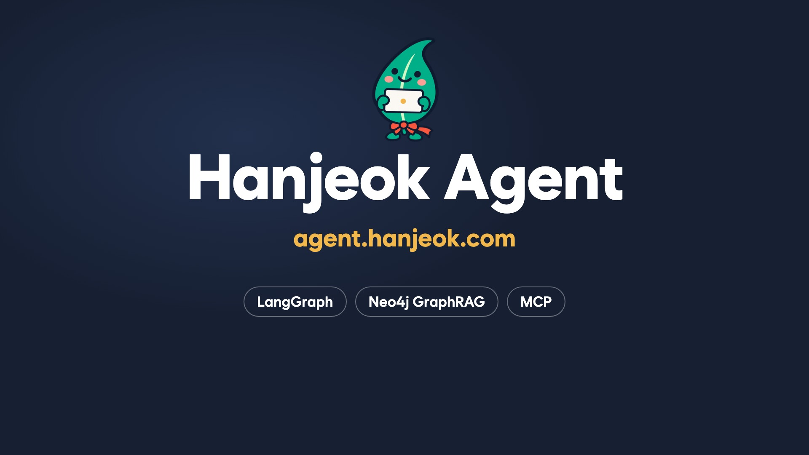
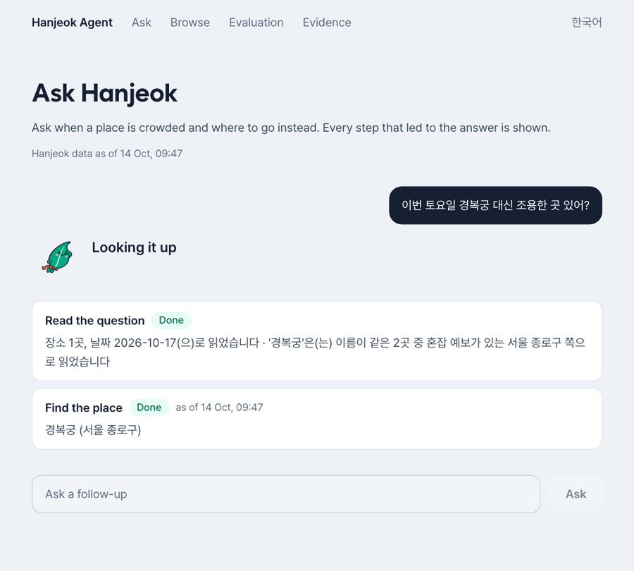
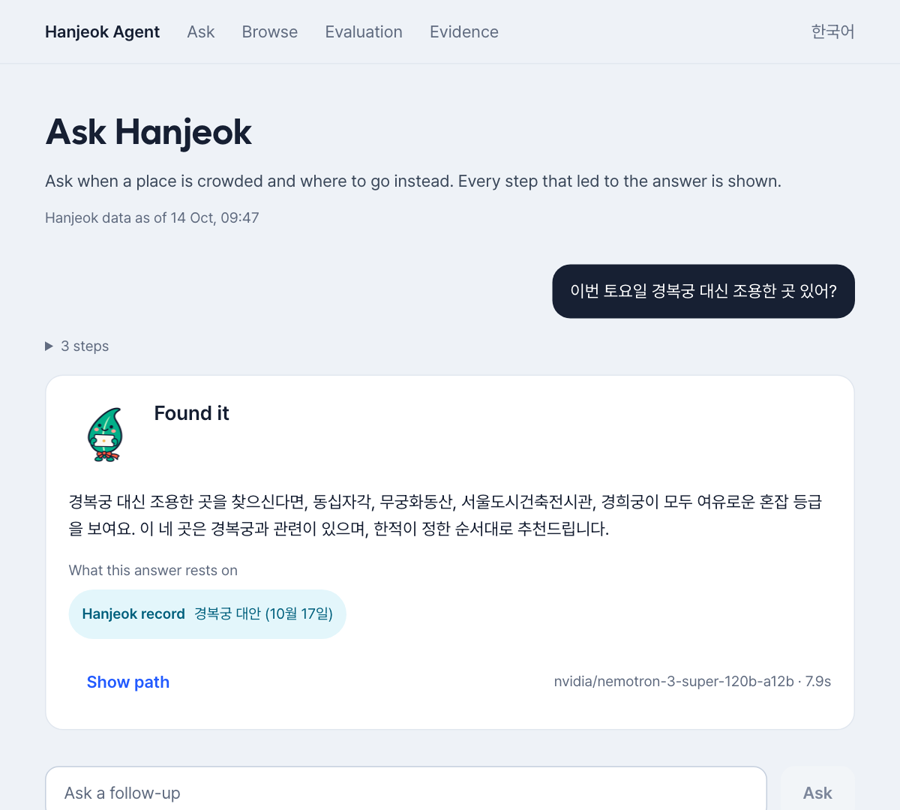
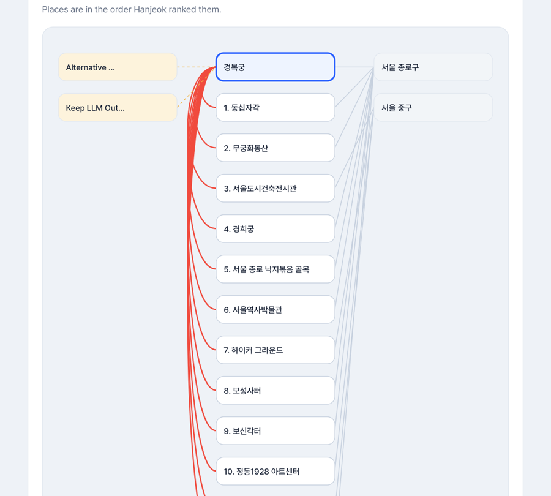
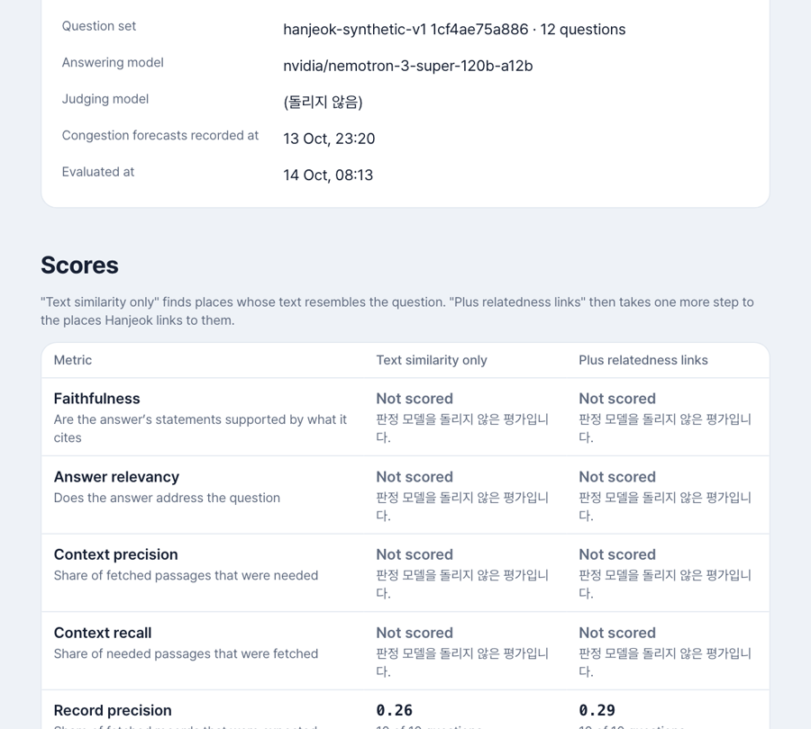
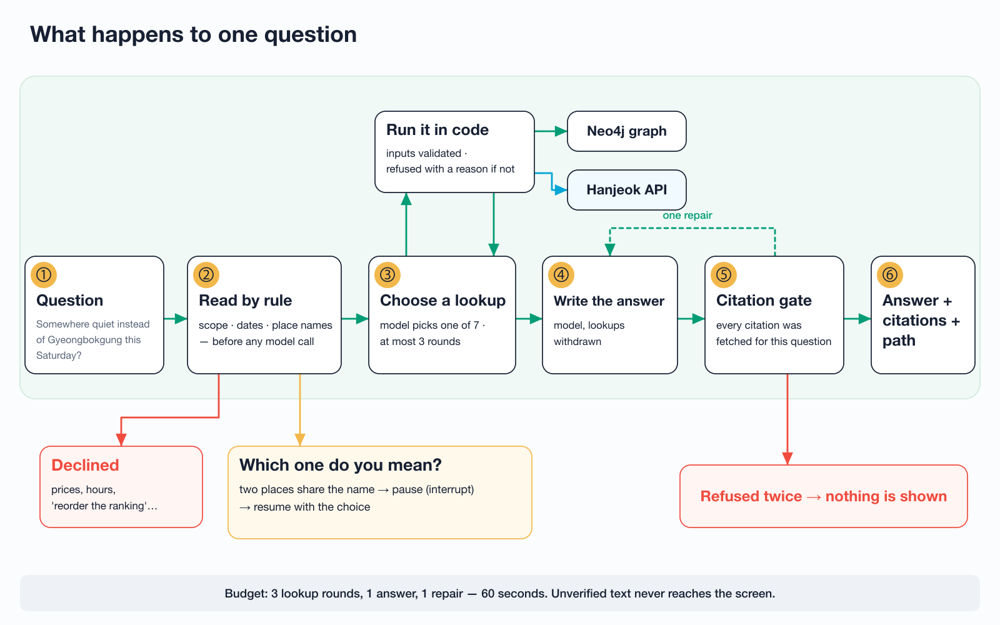
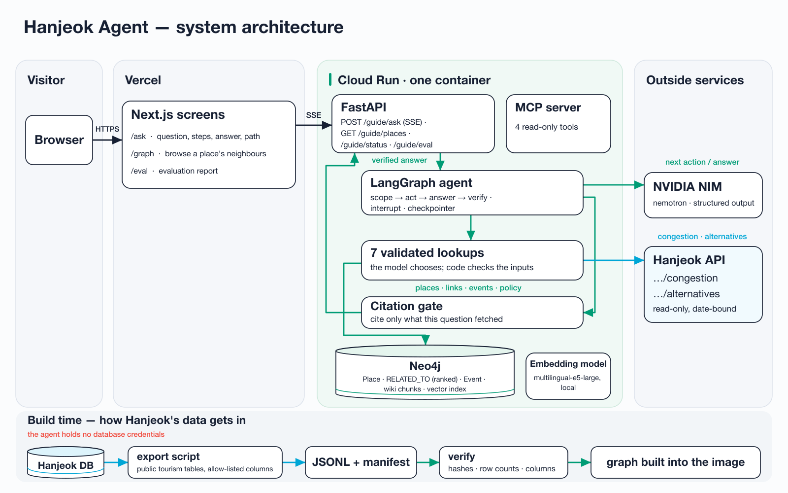

<div align="center">

<a href="https://agent.hanjeok.com"></a>

# Hanjeok Agent

**どこが混んでいるかを尋ね、その答えがどこから来たかを見る。**

旅行サービス [Hanjeok(ハンジョク)](https://hanjeok.com) の案内エージェントです。調べる手順を画面に出し、<br/>
その質問のために実際に取得したものだけを引用して答えます。

[English](./README.md) · [한국어](./README.ko.md) · **日本語** · [中文](./README.zh.md)

[](https://agent.hanjeok.com/en/ask)


<sub>この文書は <a href="./README.md">英語版</a> の翻訳です。内容に差がある場合は英語版が正です。画面と回答は韓国語と英語で提供されます。</sub>

</div>

<br/>

<div align="center">

<a href="docs/media/hanjeok-guide.mp4"></a>

<sub>20秒。実際の Hanjeok データで動く公開サイトを撮影したものです。<b><a href="docs/media/hanjeok-guide.mp4">音声付きで見る →</a></b></sub>

</div>

<br/>

## 🧭 どんな質問に答えるか

「今週の土曜、景福宮の代わりに静かな場所はある?」

検索窓では答えられない質問です。場所を見つけ、その日の混雑予報を確かめ、サービスがその場所に付けた代替地の順位を受け取る。この三つを順に行う必要があります。そして答えが返ってくると、もう一つの問いが残ります。**それは誰が言っているのか。**

| データベースに載せたチャット | Hanjeok Agent |
| :-- | :-- |
| モデルが答えを書き、利用者は信じるしかない | たどった手順がすべて画面にあり、手順ごとに何を取得したかが見える |
| モデルがもっともらしいものを選ぶ | 順位はサービスが決める。モデルは並べ替えも選択もしない |
| 滑らかな答えが根拠なしに出ることがある | この質問で取得したものだけを引用できる。できなければ答えを出さない |
| 「データなし」がいつの間にか「たぶん大丈夫」になる | 予報のない場所は不明と伝え、空いているとは言わない |

<br/>

## ✨ できること

<table>
  <tr>
    <td width="52%" valign="top"></td>
    <td valign="top">

### 尋ねて、調べる様子を見る

- 場所と日付を入れて、ふだんの言葉で尋ねます。
- 質問は**まず規則で**読みます。どの場所か、どの日付か、そもそも答えられる質問か。ここではモデルを呼びません。
- 照会が終わるたびに手順が一つずつ現れます。拒否された照会も理由とともに表示されます。

</td>
  </tr>
  <tr>
    <td valign="top"></td>
    <td valign="top">

### 確かめられる答えを受け取る

- 引用は二種類です。事実は **Hanjeok のレコード**、サービスがその事実をなぜそう扱うかは**ポリシー文書**が支えます。
- 答えは表示前に検査されます。この質問で取得していないものを引用すると通りません。一度だけ書き直させ、それでも通らなければ何も表示しません。
- 料金、営業時間、「順位を変えて」といった依頼は断り、代わりに何を尋ねられるかを伝えます。

</td>
  </tr>
  <tr>
    <td valign="top"></td>
    <td valign="top">

### 答えがたどった経路を見る

- 答えが触れた場所、つながり、文書を図と一覧で見られます。
- 代替地は **Hanjeok が付けた順位のまま**並びます。画面は並べ替えません。
- 取得したものだけを描きます。図を埋めるために足すことはしません。

</td>
  </tr>
  <tr>
    <td valign="top"></td>
    <td valign="top">

### どれだけうまく答えるかを読む

- 同じ質問を二つの検索方式で解きます。**テキスト類似度のみ**と、**関連リンクまでたどる**方式です。
- すべてのスコアに、何問から計算したかが付いています。
- 計算できなかったスコアは理由とともに**「Not scored」**と表示します。0 とは書きません。

</td>
  </tr>
</table>

質問なしで[場所の近傍を見て回る](https://agent.hanjeok.com/en/graph?place=653)こともできます。

<br/>

## ⚙️ 一つの質問が処理される流れ

<div align="center">

</div>

図のどの道を通っても、五つの規則が守られます。

1. **モデルはクエリを書きません。** 七つの照会から一つを選び、コードが入力を検証して決まった読み取りを実行します。
2. **モデルは順位を決めません。** 一覧は Hanjeok の順序で番号が付いて届き、その順序のまま渡されます。
3. **ID を推測して場所にたどり着くことはできません。** 照会は、この質問ですでに見つけた場所しか受け付けません。
4. **検証していない文章は画面に出ません。** 答えは一文字ずつ流さず、引用の検査を通ってからまとめて送ります。
5. **予算は固定です。** 照会 3 回、回答 1 回、書き直し 1 回、60 秒。

<br/>

## 🏗 システム構成

<div align="center">

</div>

**エージェントは Hanjeok のデータベースの認証情報を持ちません。** データが渡る道は二つだけです。

- **変化の遅いデータはファイルで受け取ります。** Hanjeok 側のスクリプトが、公開されている観光テーブルを許可リストの列だけ選んで書き出します。エージェントはハッシュ、行数、列を検証し、想定外の列が一つでもあればファイル全体を拒否します。グラフはコンテナイメージのビルド時にこのファイルから作られます。
- **日付に結び付くデータは質問時に取得します。** 混雑予報と代替地は、読み取り専用の Hanjeok API 二つから来ます。場所の詳細 API は呼ぶたびに閲覧数を記録するため、呼びません。

三つの部分は自前のコードではなくライブラリです。手順の配信、「どちらの場所ですか」と止まって再開すること、訪問中の以前の質問の記憶は、LangGraph のストリーム、`interrupt`、チェックポインターが担います。類似検索は neo4j-graphrag の `VectorCypherRetriever` が行います。MCP サーバーは読み取り専用のツール四つを公開し、ほかのプログラム(将来的には Hanjeok のバックエンド)がエージェントに尋ねられるようにします。

<br/>

## 📊 これまでに測ったもの

測ったものは少なく、少ないとそのまま書きます。

| | |
| :-- | :-- |
| **デプロイ済みサービスのデータ** | 場所 13,403 件、関連リンク 45,244 件、イベント 353 件。2026-10-14 に Hanjeok から書き出したもの |
| **テスト** | バックエンド 408 件(ネットワークもキーも不要)、実際の Neo4j で 16 件、フロントエンド 246 件 |
| **ゼロからの起動** | 約 30 秒(Neo4j 19 秒、サーバー 10 秒) |
| **起動後の質問一つ** | 6〜9 秒。モデル提供元のレート制限にかかると最大 56 秒 |

公開している評価は、**Hanjeok の実データに対する 60 問**です。2026-10-14 のエクスポートを使い、六つの種類ごとに 10 問ずつ尋ねました。RAGAS の判定は実行していません。Hanjeok の混雑予報と代替地は一度録画した応答を再生しました。どちらの方式も 41 問に答え、12 問を断り、7 問で失敗しました。

| | テキスト類似度のみ | 関連リンクまで |
| :-- | :-: | :-: |
| 必要なレコードを取得できた割合 | 0.725(50 問) | 0.86(50 問) |
| 同上、つながった二つ以上の場所を尋ねる質問 | 0.025(10 問) | 0.60(10 問) |
| 答えるべきでない質問を断った数 | 10 問中 10 問 | 10 問中 10 問 |
| 禁止行動の件数(60 回答中) | 9 件 | 4 件 |

禁止行動の多くは根拠のない主張です(6 件と 3 件)。レコード適合率は 0.23 と 0.27 です。照会と一緒に取得される場所レコードやポリシー文書も分母に入るため低く出る値で、二つの方式を比べるためのものです。以前の架空の場所による 12 問は、テスト用としてリポジトリに残っています。

> [!NOTE]
> **まだ行っていないこと。** RAGAS のスコアです。判定は一度実行しましたが、ほかのプロジェクトと共有しているモデルキーでは 72 件の要求のうち 1 件しか応答がなく、残りはレート制限にかかりました。評価ページではそのセルを「Not scored」と表示しています。

> [!WARNING]
> **誤った答えが引用の検査を通ったことがあります。** 実データで、エージェントが代替地を「近い順」と説明したことがあり(実際は Hanjeok のスコア順)、予報を取得していない海水浴場を「今日は空いている」と述べたことがあります。どちらも実際に取得したレコードを引用していましたが、主張がそのレコードを超えていました。いまは二つの禁止行動の規則がこれらを捉え、エージェントはそうした答えを一度書き直しに戻します。60 問の評価では、二つの規則はどちらも 0 件でした。

<br/>

## 🛠 技術スタック

| 領域 | 使用しているもの |
| :-- | :-- |
| エージェントサービス | Python 3.13 · FastAPI · LangGraph(ストリーム、`interrupt`、チェックポインター)· LangChain |
| グラフと検索 | Neo4j 5.26 · neo4j-graphrag `VectorCypherRetriever` · multilingual-e5-large(1024 次元、ローカル) |
| モデル | NVIDIA NIM nemotron、構造化出力 |
| ほかのプログラムとの接続 | MCP サーバー、読み取り専用ツール四つ |
| 評価 | RAGAS · レコード ID に基づく適合率と再現率 · 規則による禁止行動カウンター八つ |
| 画面 | Next.js 16 · React 19 · Tailwind 4 |
| デプロイ | Cloud Run(サービスと Neo4j を一つのコンテナに)· Vercel · Cloud Build |
| トレース | Langfuse。キーを設定したときだけ有効 |

<br/>

## 🗂 リポジトリの案内

| パス | 内容 |
| :-- | :-- |
| [`bench/src/guide/`](bench/src/guide/) | エージェント本体。スコープの規則、照会、LangGraph のループ、引用ゲート、API、MCP サーバー、評価 |
| [`bench/tests/`](bench/tests/) | 単体・契約・Neo4j 統合テストと、架空の場所で作った合成エクスポート |
| [`bench/Dockerfile`](bench/Dockerfile) · [`bench/deploy/`](bench/deploy/) | サービス、Neo4j、構築済みグラフを収めるイメージ |
| [`frontend/`](frontend/) | 四つの画面 |
| [`specs/002-hanjeok-guide-agent/`](specs/002-hanjeok-guide-agent/) | 仕様、調査した決定、データモデル、契約、タスク |
| [`docs/prd/`](docs/prd/hanjeok-guide-agent.md) | 製品要件(韓国語) |
| [`docs/deploy.md`](docs/deploy.md) | デプロイ方法と実際に実行したコマンド(韓国語) |
| [`server/`](server/) | 以前のコース説明サービス(Kotlin、Spring AI)。下記参照 |

### 中心となる考えをコードで読む場所

- [`scope.py`](bench/src/guide/scope.py): モデルを呼ぶ前に質問について決めること
- [`lookups.py`](bench/src/guide/lookups.py): 七つの照会と、それぞれが拒否するもの
- [`agent.py`](bench/src/guide/agent.py): LangGraph のループ、一時停止、予算
- [`citations.py`](bench/src/guide/citations.py): 引用ゲート
- [`export.py`](bench/src/guide/export.py): マニフェストと一致しないエクスポートを拒否する
- [`forbidden.py`](bench/src/guide/forbidden.py): 規則で数える八つの禁止行動

<br/>

## 🚀 ローカルで動かす

画面だけを起動し、録画済みの応答を再生します。Node 22 と pnpm が必要です。

```bash
cd frontend
pnpm install
pnpm dev          # http://localhost:3000/en/ask
```

合成データでサービスを起動します。Python 3.13、uv、Docker が必要です。

```bash
cd bench
docker compose up -d
uv sync
uv run guide refresh --export tests/fixtures/hanjeok-export
GUIDE_LIVE_MODE=replay uv run uvicorn guide.api:app --port 8090   # 回答には NVIDIA_API_KEY が必要

uv run pytest                    # 408 件、ネットワーク不要
uv run guide mcp                 # 同じエージェントを MCP で(stdio)
```

画面をサービスにつなぐには `NEXT_PUBLIC_GUIDE_BASE_URL=http://localhost:8090 pnpm dev` で起動します。

<br/>

## ⚠️ 既知の制限

- **しばらく使われなかった後の最初の質問は約 30 秒待ちます。** サービスがゼロまで縮小するためで、画面は起動中であることを伝えます。
- **モデルキーをほかのプロジェクトと共有しています。** レート制限にかかると質問が遅くなるか失敗します。
- **二文字の地名は控えめに照合します。** それでも「地図で近い場所」の「지도(地図)」は、同名の島として読まれます。
- **訪問の記録と利用上限はメモリ上にあります。** そのためサービスは一つのインスタンスで動かしています。
- **案内キャラクターの画像**は Codex の画像生成で作りました。商標と AI 生成画像の著作権の確認は行っておらず、作者が 2026-10-14 に公開を決めました。記録は [`provenance.json`](design/guide-character/v1/provenance.json) にあります。

<br/>

## 📚 以前の構成要素: コース説明サービス

案内エージェントの前、このリポジトリが説明していたのは一つだけでした。Hanjeok のバックエンドがすでに作った旅行コースを、そのコースが表示される画面で説明することです。そのサービス(Kotlin、Spring AI)は今も [agent.hanjeok.com](https://agent.hanjeok.com) で動いています。八つの禁止行動を数えるハーネスや、`gpt-4o` を選んだモデル比較を含む説明は、そのまま残してあります。

**[コース説明サービスの README →](docs/explainer/README.md)** · [한국어](docs/explainer/README.ko.md)

<br/>

## 👤 作者

<div align="center">

|  |
| :---: |
| [hyunolike](https://github.com/hyunolike) |

</div>

2026 年のオープンソース AI エージェント・フルスタック課程のプロジェクトとして作りました。残りの作業は [issues](https://github.com/hyunolike/hanjeok-agent/issues) で管理しています。

## 📄 ライセンス

[MIT](LICENSE) — © 2026 hyunolike.
