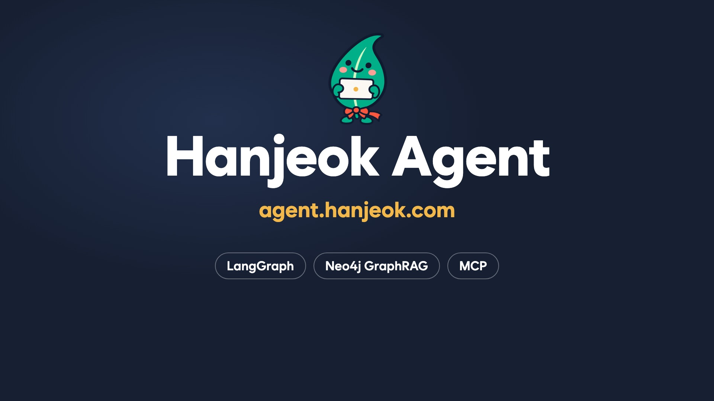
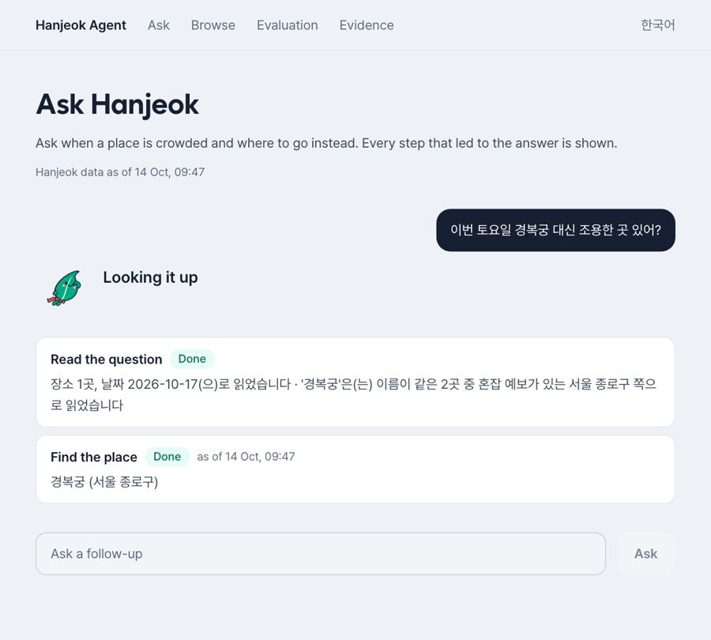
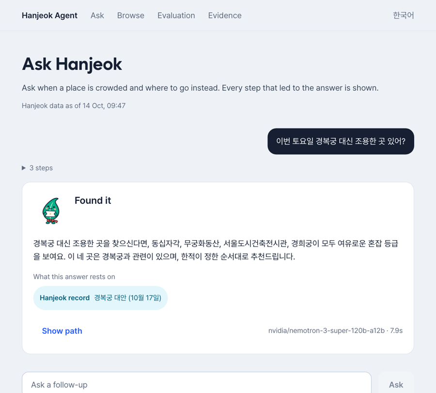
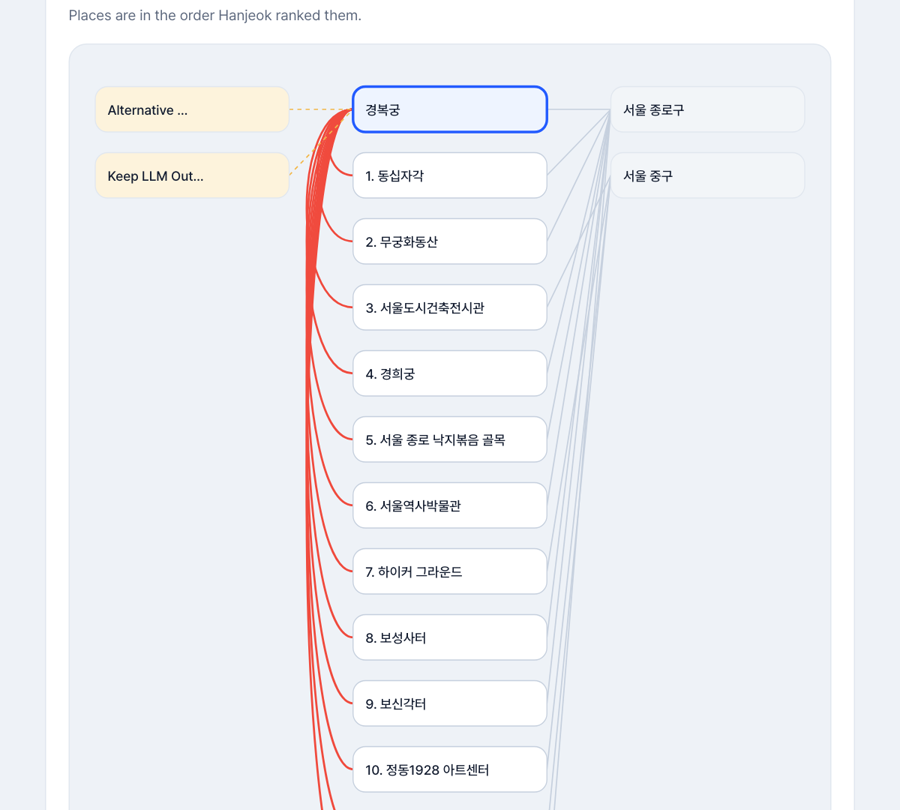
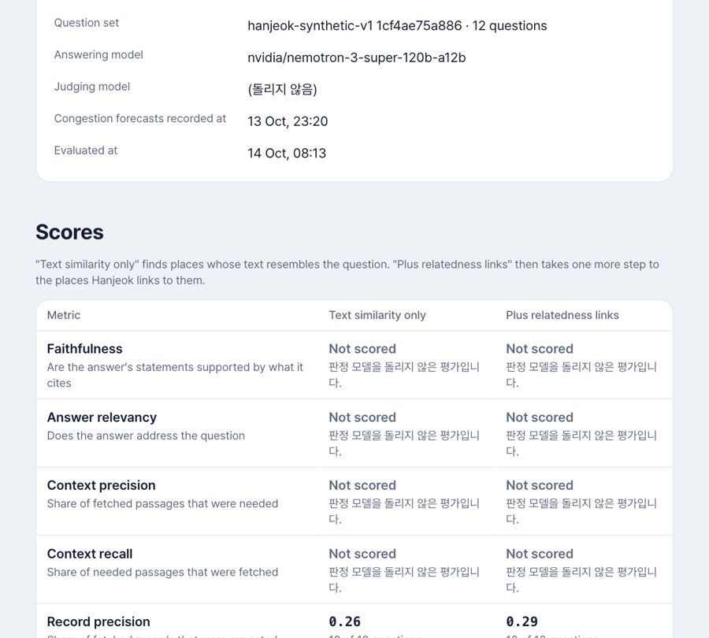
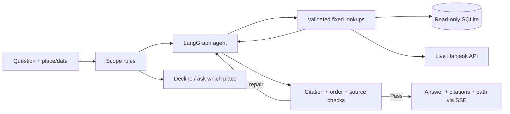
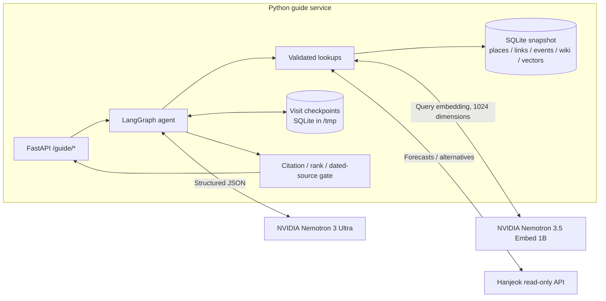
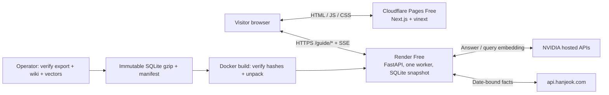

<div align="center">

<a href="https://agent.hanjeok.com"></a>

# Hanjeok Agent

**どこが混んでいるかを尋ね、その答えがどこから来たかを見る。**

旅行サービス [Hanjeok(ハンジョク)](https://hanjeok.com) の案内エージェントです。調べる手順を画面に出し、<br/>
その質問のために実際に取得したものだけを引用して答えます。

[English](./README.md) · [한국어](./README.ko.md) · **日本語** · [中文](./README.zh.md)

[](https://agent.hanjeok.com/en/ask)


<sub>以前のデプロイで撮影した20秒のデモです。現在の構成と検証は以下を参照してください。</sub>

</div>

<br/>

<div align="center">

<a href="docs/media/hanjeok-guide.mp4"></a>

<sub>20秒。実際の Hanjeok データで動く公開サイトを撮影したものです。<b><a href="docs/media/hanjeok-guide.mp4">音声付きで見る →</a></b></sub>

</div>

<br/>

## 🧭 どんな質問に答えるか

「今週の土曜、景福宮の代わりに静かな場所はある?」

検索窓では答えられない質問です。場所を見つけ、その日の混雑予報を確かめ、サービスがその場所に付けた代替地の順位を受け取る。この三つを順に行う必要があります。そして答えが返ってくると、もう一つの問いが残ります。**それは誰が言っているのか。**

| データベースに載せたチャット | Hanjeok Agent |
| :-- | :-- |
| モデルが答えを書き、利用者は信じるしかない | たどった手順がすべて画面にあり、手順ごとに何を取得したかが見える |
| モデルがもっともらしいものを選ぶ | 順位はサービスが決める。モデルは並べ替えも選択もしない |
| 滑らかな答えが根拠なしに出ることがある | この質問で取得したものだけを引用できる。できなければ答えを出さない |
| 「データなし」がいつの間にか「たぶん大丈夫」になる | 予報のない場所は不明と伝え、空いているとは言わない |

<br/>

## ✨ できること

<table>
  <tr>
    <td width="52%" valign="top"></td>
    <td valign="top">

### 尋ねて、調べる様子を見る

- 場所と日付を入れて、ふだんの言葉で尋ねます。
- 質問は**まず規則で**読みます。どの場所か、どの日付か、そもそも答えられる質問か。ここではモデルを呼びません。
- 照会が終わるたびに手順が一つずつ現れます。拒否された照会も理由とともに表示されます。

</td>
  </tr>
  <tr>
    <td valign="top"></td>
    <td valign="top">

### 確かめられる答えを受け取る

- 引用は二種類です。事実は **Hanjeok のレコード**、サービスがその事実をなぜそう扱うかは**ポリシー文書**が支えます。
- 答えは表示前に検査されます。この質問で取得していないものを引用すると通りません。一度だけ書き直させ、それでも通らなければ何も表示しません。
- 料金、営業時間、「順位を変えて」といった依頼は断り、代わりに何を尋ねられるかを伝えます。

</td>
  </tr>
  <tr>
    <td valign="top"></td>
    <td valign="top">

### 答えがたどった経路を見る

- 答えが触れた場所、つながり、文書を図と一覧で見られます。
- 代替地は **Hanjeok が付けた順位のまま**並びます。画面は並べ替えません。
- 取得したものだけを描きます。図を埋めるために足すことはしません。

</td>
  </tr>
  <tr>
    <td valign="top"></td>
    <td valign="top">

### どれだけうまく答えるかを読む

- 同じ質問を二つの検索方式で解きます。**テキスト類似度のみ**と、**関連リンクまでたどる**方式です。
- すべてのスコアに、何問から計算したかが付いています。
- 計算できなかったスコアは理由とともに**「Not scored」**と表示します。0 とは書きません。

</td>
  </tr>
</table>

質問なしで[場所の近傍を見て回る](https://agent.hanjeok.com/en/graph?place=10000028)こともできます。

<br/>

## ⚙️ 一つの質問が処理される流れ



図のどの道を通っても、五つの規則が守られます。

1. **モデルはクエリを書きません。** 七つの照会から一つを選び、コードが入力を検証して決まった読み取りを実行します。
2. **モデルは順位を決めません。** 一覧は Hanjeok の順序で番号が付いて届き、その順序のまま渡されます。
3. **ID を推測して場所にたどり着くことはできません。** 照会は、この質問ですでに見つけた場所しか受け付けません。
4. **検証していない文章は画面に出ません。** 答えは一文字ずつ流さず、引用の検査を通ってからまとめて送ります。
5. **予算は固定です。** 照会 3 回、回答 1 回、書き直し 1 回、60 秒。

<br/>

場所と日付が一つに確定した代替地の要求は、日付別 API の取得レコードを引用する必要があります。場所の類似検索をサービスの代替順位として説明できません。

## 🏗 システム構成



**場所とポリシーは読み取り専用 SQLite、日付ごとの事実は Hanjeok API から取得します。** 回答とクエリ埋め込みは NVIDIA HTTP API を利用します。公開 API コンテナに Neo4j サーバーやローカルモデルの重みは含めません。

- **事前準備:** 公開列のみの JSONL と manifest を検証し、場所・固定 wiki・検証済みベクトルを SQLite にまとめます。イメージのビルド時にハッシュを検証して展開します。更新には新しいファイルの準備と再デプロイが必要です。
- **質問時:** 混雑予報と日付別の代替地は読み取り専用 API から取得します。閲覧数を記録する場所詳細 API は呼ばず、本番 DB の認証情報も持ちません。
- **検索と状態:** `sqlite-vec` の正確なコサイン検索と固定 SQL を使います。LangGraph が手順と聞き返しを処理し、チェックポイントは `/tmp` の別 SQLite に保存します。訪問状態と利用上限はプロセス再起動で初期化されます。
- **既存の経路:** Neo4j アダプターと MCP CLI は残しています。公開構成は `GUIDE_STORE=sqlite` の HTTP API で、MCP ポートは公開しません。

[実装](bench/src/guide/sqlite_store.py) · [ファイル準備](bench/deploy/prepare_sqlite.py) · [以前の構成と README](docs/archive/guide-before-sqlite/README.ja.md)

<br/>

## ☁️ デプロイ構成



| 部分 | 現在の構成 |
| :-- | :-- |
| 画面 | [agent.hanjeok.com](https://agent.hanjeok.com/en/ask)、Cloudflare Pages Free |
| API | [hanjeok-guide.onrender.com](https://hanjeok-guide.onrender.com/guide/ready)、Render Free |
| プロセス | Python 3.13、FastAPI、uvicorn ワーカー1、同時質問1 |
| データ | イメージ内の読み取り専用 SQLite。外部 DB の認証は不要 |
| シークレット | 既存の `NVIDIA_API_KEY` を Render の環境変数で注入 |
| 準備確認 | `/guide/ready` はファイル・スキーマ・件数・ベクトル識別子を検証して200。提供元の可用性は実際の質問で確認 |
| 接続 | `NEXT_PUBLIC_GUIDE_BASE_URL` を設定して再ビルドし、ブラウザから API に直接 SSE 接続 |

2026-11-24 に公開デプロイと実際のブラウザ回答を確認しました。Render は作業ブランチの指定コミットを手動デプロイします。Pages の `--branch main` は本番ラベルで、Git main のマージではありません。

[現在のデプロイ手順](docs/deploy.md) · [512MiB 設定とデータ更新](deployment/guide-free/README.md) · [検証記録](bench/reports/runtime/sqlite-deployment.json) · [以前のデプロイ記録](docs/archive/guide-before-sqlite/deploy.md)

<br/>

## 📊 これまでに測ったもの

2026-11-24 に確認した現在の構成です。

| 項目 | 観測結果 |
| :-- | :-- |
| データ | 2026-11-23 export: 場所12,106、関連リンク43,087、イベント209、地域229 |
| Wiki | 固定 revision `7fc19c0`、18文書 / 83チャンク |
| 基本テスト | バックエンド525成功、統合・実モデル検査43除外、フロントエンド296成功 |
| 512MiB 検査 | 最終イメージのローカル amd64 エミュレーションで20ms標本最大297.7MiB、swap/OOMなし。Render 自体の測定ではない |
| 公開ブラウザ | 景福宮予報の回答、原本引用、Ultra 表示を確認。一度の観測で7.6秒 |
| 実応答 | 公開の予報・ポリシーは取得元と引用の検査に成功。代替地は正しい API 取得後にモデル呼び出しが失敗し、全体 smoke は `passed=false` |

**SQLite の全60問品質評価は未実行です。** 以前の Neo4j/E5 や別モデルのスコアを現在の結果として使いません。[以前の README](docs/archive/guide-before-sqlite/README.ja.md) に評価表と制限を保存しています。

[メモリと実応答](bench/reports/runtime/sqlite-512mb-source-guard-amd64.json) · [公開 SSE](bench/reports/runtime/sqlite-public-sse-postguard.json) · [画面](bench/reports/runtime/sqlite-public-forecast.jpg)

<br/>

## 🛠 技術スタック

| 領域 | 使用技術 |
| :-- | :-- |
| エージェント | Python 3.13、FastAPI、LangGraph、LangChain |
| 現在のデータ・検索 | 読み取り専用 SQLite、`sqlite-vec` 正確コサイン検索、固定 SQL |
| 回答モデル | NVIDIA `nvidia/nemotron-3-ultra-550b-a55b`、構造化 JSON |
| クエリ埋め込み | NVIDIA `nvidia/nemotron-3.5-embed-1b`、1024次元、HTTP |
| 訪問状態 | `/tmp` の LangGraph SQLite チェックポイント、メモリ上の訪問・上限 |
| 画面 | Next.js 16、React 19、Tailwind 4、vinext |
| デプロイ | Cloudflare Pages Free + Render Free、`bench/Dockerfile.api` |
| 別のツール・実験 | Neo4j アダプター、MCP CLI、運用者用評価と RAGAS。公開 API プロセスでは実行しない |
| トレース | キー設定時のみ Langfuse を有効化 |

<br/>

## 🗂 リポジトリの案内

| パス | 内容 |
| :-- | :-- |
| [`bench/src/guide/`](bench/src/guide/) | エージェント本体。スコープの規則、照会、LangGraph のループ、引用ゲート、API、MCP サーバー、評価 |
| [`bench/tests/`](bench/tests/) | 単体・契約・Neo4j 統合テストと、架空の場所で作った合成エクスポート |
| [`bench/Dockerfile.api`](bench/Dockerfile.api) · [`bench/deploy/`](bench/deploy/) | 現在の読み取り専用 SQLite API と運用者用準備・検証ツール。`bench/Dockerfile` は以前の Neo4j 同居構成として保存 |
| [`frontend/`](frontend/) | 四つの画面と、動く構成図でエージェントを紹介するホーム |
| [`specs/002-hanjeok-guide-agent/`](specs/002-hanjeok-guide-agent/) | 仕様、調査した決定、データモデル、契約、タスク |
| [`docs/prd/`](docs/prd/hanjeok-guide-agent.md) | 製品要件(韓国語) |
| [`docs/deploy.md`](docs/deploy.md) | 現在の Render/Cloudflare 手順と以前のデプロイ記録へのリンク |
| [`server/`](server/) | 以前のコース説明サービス(Kotlin、Spring AI)。下記参照 |

### 中心となる考えをコードで読む場所

- [`scope.py`](bench/src/guide/scope.py): モデルを呼ぶ前に質問について決めること
- [`lookups.py`](bench/src/guide/lookups.py): 七つの照会と、それぞれが拒否するもの
- [`agent.py`](bench/src/guide/agent.py): LangGraph のループ、一時停止、予算
- [`citations.py`](bench/src/guide/citations.py): 引用ゲート
- [`export.py`](bench/src/guide/export.py): マニフェストと一致しないエクスポートを拒否する
- [`forbidden.py`](bench/src/guide/forbidden.py): 規則で数える八つの禁止行動

<br/>

## 🚀 ローカルで動かす

画面だけを起動し、録画済みの応答を再生します。Node 22 と pnpm が必要です。

```bash
cd frontend
pnpm install
pnpm dev          # http://localhost:3000/en/ask
```

現在と同じ SQLite API はリポジトリのルートで起動します。[環境変数例](deployment/guide-free/env.example) をリポジトリ外へコピーし、NVIDIA キーとローカル CORS origin を設定してください。

```bash
docker build -f bench/Dockerfile.api -t hanjeok-guide:api bench
docker run --rm --memory 512m --memory-swap 512m --cpus 1 \
  --env-file /path/outside-repository/guide.env -e GUIDE_STORE=sqlite \
  -p 127.0.0.1:8090:8000 hanjeok-guide:api
```

以前の Neo4j アダプターを合成データで動かす方法も残しています。Python 3.13、uv、Docker が必要です。

```bash
cd bench
docker compose up -d
uv sync
uv run guide refresh --export tests/fixtures/hanjeok-export
GUIDE_LIVE_MODE=replay uv run uvicorn guide.api:app --port 8090   # 回答には NVIDIA_API_KEY が必要

uv run pytest                    # offline tests
uv run guide mcp                 # 同じエージェントを MCP で(stdio)
```

画面をサービスにつなぐには `NEXT_PUBLIC_GUIDE_BASE_URL=http://localhost:8090 pnpm dev` で起動します。

<br/>

## ⚠️ 既知の制限

- **無料インスタンスはアイドル時に休止する場合があります。** SQLite 移行後のコールドスタート時間は再測定していません。
- **モデル呼び出しの失敗は残っています。** 代替地の取得に成功しても回答生成に失敗する場合があり、全ての実応答検査が成功したわけではありません。
- **モデルキーをほかのプロジェクトと共有しています。** レート制限にかかると質問が遅くなるか失敗します。
- **二文字の地名は控えめに照合します。** それでも「地図で近い場所」の「지도(地図)」は、同名の島として読まれます。
- **訪問の記録と利用上限はメモリ上にあります。** そのためサービスは一つのインスタンスで動かしています。
- **案内キャラクターの画像**は Codex の画像生成で作りました。商標と AI 生成画像の著作権の確認は行っておらず、作者が 2026-10-14 に公開を決めました。記録は [`provenance.json`](design/guide-character/v1/provenance.json) にあります。ホームの紹介イラストと、構成図の中を動く葉っぱの絵二枚も同じ方法で作り、同じく確認していません。記録は [`design/home-intro/v1/`](design/home-intro/v1/) と [`design/agent-flow/v1/`](design/agent-flow/v1/) にあります。
- **構成図の技術ロゴ**は各社の商標です。どこで何が動くかを示すために、[simple-icons](https://simple-icons.org)(CC0)の公式マークを変更せずに使っています。

<br/>

## 📚 以前の構成要素: コース説明サービス

案内エージェントの前、このリポジトリが説明していたのは一つだけでした。Hanjeok のバックエンドがすでに作った旅行コースを、そのコースが表示される画面で説明することです。Kotlin/Spring AI のコードと当時の記録は保存しています。今回の無料移行は Python の案内 API が対象です。八つの禁止行動を数えるハーネスや、`gpt-4o` を選んだモデル比較を含む説明は、そのまま残してあります。

**[コース説明サービスの README →](docs/explainer/README.md)** · [한국어](docs/explainer/README.ko.md)

<br/>

## 👤 作者

<div align="center">

|  |
| :---: |
| [hyunolike](https://github.com/hyunolike) |

</div>

2026 年のオープンソース AI エージェント・フルスタック課程のプロジェクトとして作りました。残りの作業は [issues](https://github.com/hyunolike/hanjeok-agent/issues) で管理しています。

## 📄 ライセンス

[MIT](LICENSE) — © 2026 hyunolike.
