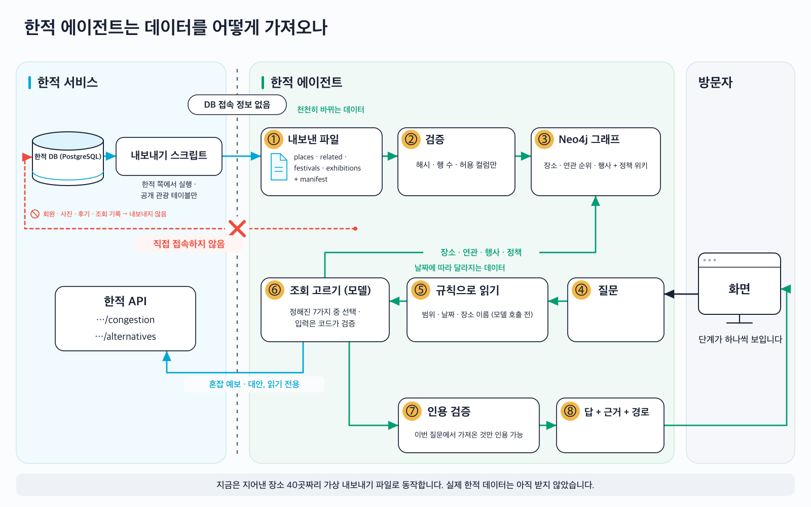

<div align="center">

<a href="https://agent.hanjeok.com"></a>

# 한적 에이전트

**어디가 붐비는지 묻고, 그 답이 어디에서 왔는지 봅니다.**

[한적](https://hanjeok.com) 서비스의 여행 안내 에이전트입니다. 찾아보는 단계를 화면에 보여 주고,<br/>
그 질문에서 실제로 가져온 것만 인용해 답합니다.

[English](./README.md) · **한국어** · [日本語](./README.ja.md) · [中文](./README.zh.md)

[](https://agent.hanjeok.com/ko/ask)


</div>

<br/>

<div align="center">

<a href="docs/media/hanjeok-guide.mp4"></a>

<sub>20초. 실제 한적 데이터로 도는 공개 사이트를 캡처했습니다. <b><a href="docs/media/hanjeok-guide.mp4">소리와 함께 보기 →</a></b></sub>

</div>

<br/>

## 🧭 어떤 질문에 답하나

"이번 토요일 경복궁 대신 조용한 곳 있어?"

검색창으로는 답할 수 없는 질문입니다. 장소를 찾고, 그 날짜의 혼잡 예보를 확인하고, 서비스가 그 장소에 매긴 대안 순위를 받아야 합니다. 세 가지를 차례로 해야 하고, 답을 받고 나면 질문이 하나 더 남습니다. **그걸 누가 그렇다고 했나?**

| 데이터베이스 위에 얹은 챗봇 | 한적 에이전트 |
| :-- | :-- |
| 모델이 답을 쓰고 사용자는 믿는다 | 거친 단계가 전부 화면에 있고, 단계마다 무엇을 가져왔는지 보인다 |
| 모델이 그럴듯한 것을 고른다 | 순위는 서비스가 정하고, 모델은 순서를 바꾸거나 고르지 않는다 |
| 매끄러운 답이 아무 근거 없이 나올 수 있다 | 이번 질문에서 가져온 것만 인용할 수 있고, 아니면 답을 보여 주지 않는다 |
| "데이터 없음"이 슬그머니 "괜찮을 것"이 된다 | 예보가 없는 장소는 모른다고 말하고, 한적하다고 말하지 않는다 |

<br/>

## ✨ 할 수 있는 것

<table>
  <tr>
    <td width="52%" valign="top"></td>
    <td valign="top">

### 묻고, 찾아보는 과정을 본다

- 장소와 날짜를 넣어 평소 말하듯 묻습니다.
- 질문은 **규칙으로 먼저** 읽습니다. 어느 장소인지, 어느 날짜인지, 답할 수 있는 질문인지를 여기서 정하고, 이 단계에서는 모델을 부르지 않습니다.
- 조회가 끝날 때마다 단계가 하나씩 나타납니다. 거절된 조회도 이유와 함께 보입니다.

</td>
  </tr>
  <tr>
    <td valign="top"></td>
    <td valign="top">

### 확인할 수 있는 답을 받는다

- 인용은 두 종류입니다. 사실은 **한적 레코드**가, 한적이 그 사실을 왜 그렇게 다루는지는 **정책 문서**가 뒷받침합니다.
- 답은 보여 주기 전에 검사합니다. 이번 질문에서 가져오지 않은 것을 인용하면 통과하지 못하고, 한 번 고쳐 쓰게 한 뒤에도 실패하면 아무것도 보여 주지 않습니다.
- 요금, 운영 시간, "순위를 바꿔 줘" 같은 요청은 거절하고, 대신 무엇을 물을 수 있는지 알려 줍니다.

</td>
  </tr>
  <tr>
    <td valign="top"></td>
    <td valign="top">

### 답이 지나온 경로를 본다

- 답이 거친 장소와 연결, 문서를 그림과 목록으로 봅니다.
- 대안은 **한적이 매긴 순위 그대로** 놓입니다. 화면이 다시 정렬하지 않습니다.
- 가져온 것만 그립니다. 그림을 채우려고 더하지 않습니다.

</td>
  </tr>
  <tr>
    <td valign="top"></td>
    <td valign="top">

### 얼마나 잘하는지 읽는다

- 같은 질문을 두 가지 검색 방식으로 풉니다. **글 유사도만** 쓰는 방식과 **연관 링크까지** 따라가는 방식입니다.
- 점수마다 몇 문항으로 계산했는지 붙어 있습니다.
- 계산하지 못한 점수는 이유와 함께 **"채점 못 함"**으로 적습니다. 0으로 적지 않습니다.

</td>
  </tr>
</table>

질문 없이 [장소의 이웃을 둘러볼](https://agent.hanjeok.com/ko/graph?place=653) 수도 있습니다.

<br/>

## ⚙️ 질문 하나가 처리되는 과정

<div align="center">

</div>

그림의 어느 길로 가든 다섯 가지 규칙이 지켜집니다.

1. **모델은 쿼리를 쓰지 않습니다.** 조회 일곱 가지 중 하나를 고르고, 코드가 입력을 검증해 정해진 조회를 실행합니다.
2. **모델은 순위를 정하지 않습니다.** 목록은 한적의 순서대로 번호가 붙어 오고, 그 순서 그대로 전달됩니다.
3. **id를 짐작해서 장소에 닿을 수 없습니다.** 조회는 이번 질문에서 이미 찾은 장소만 받습니다.
4. **검증하지 않은 글은 화면에 나오지 않습니다.** 답은 한 글자씩 흘려보내지 않고, 인용 검사를 통과한 뒤 통째로 보냅니다.
5. **예산이 정해져 있습니다.** 조회 3번, 답 1번, 고쳐 쓰기 1번, 60초입니다.

<br/>

## 🏗 시스템 구조

<div align="center">

</div>

**에이전트는 한적 데이터베이스의 접속 정보를 갖지 않습니다.** 데이터가 넘어오는 길은 둘뿐입니다.

- **잘 바뀌지 않는 데이터는 파일로 받습니다.** 한적 쪽 스크립트가 공개 관광 테이블을 허용 목록의 컬럼만 골라 내보냅니다. 에이전트는 해시와 행 수, 컬럼을 검증하고, 예상하지 않은 컬럼이 하나라도 있으면 파일 전체를 거절합니다. 그래프는 컨테이너 이미지를 만들 때 이 파일로 만듭니다.
- **날짜에 묶인 데이터는 질문을 받을 때 조회합니다.** 혼잡 예보와 대안은 읽기 전용 한적 API 두 개에서 옵니다. 장소 상세 API는 부를 때마다 조회수를 남기기 때문에 부르지 않습니다.

세 부분은 직접 짠 코드가 아니라 라이브러리입니다. 단계 전달과 "어느 곳인가요?" 하고 멈췄다 이어 가기, 방문의 앞 질문 기억은 LangGraph의 스트림과 `interrupt`, 체크포인터가 맡습니다. 유사도 검색은 neo4j-graphrag의 `VectorCypherRetriever`가 합니다. MCP 서버는 읽기 전용 도구 네 개를 내놓아 다른 프로그램이 에이전트에게 물을 수 있게 하고, 나중에는 한적 백엔드가 이 입구로 호출하게 됩니다.

<details>
<summary>데이터가 들어오는 길을 한국어 그림으로 보기</summary>
<br/>

</details>

<br/>

## 📊 지금까지 잰 것

잰 것이 적고, 적다는 것을 그대로 적습니다.

| | |
| :-- | :-- |
| **배포된 서비스의 데이터** | 관광지 13,403곳, 연관 관계 45,244건, 행사 353건. 2026-10-14에 한적에서 내보낸 것 |
| **테스트** | 서버 408개(네트워크와 키 없이), 실제 Neo4j로 16개, 화면 246개 |
| **0에서 깨어나는 시간** | 약 30초 (Neo4j 19초, 서버 10초) |
| **깨어 있을 때 질문 하나** | 6~9초. 모델 제공자의 요청 한도에 걸리면 56초까지 |

공개한 평가는 **한적 실데이터에 대한 60문항**입니다. 2026-10-14에 내보낸 데이터로 여섯 종류마다 10문항씩 물었고, RAGAS 판정은 돌리지 않았습니다. 한적의 혼잡 예보와 대안은 한 번 녹화한 응답을 다시 썼습니다. 두 방식 모두 41문항에 답했고 12문항을 거절했으며 7문항에서 실패했습니다.

| | 글 유사도만 | 연관 링크까지 |
| :-- | :-: | :-: |
| 필요한 레코드를 가져온 비율 | 0.725 (50문항) | 0.86 (50문항) |
| 같은 비율, 이어진 장소 둘 이상을 묻는 질문 | 0.025 (10문항) | 0.60 (10문항) |
| 답하면 안 되는 질문 거절 | 10문항 중 10문항 | 10문항 중 10문항 |
| 금지 행동 건수 (답 60개 기준) | 9건 | 4건 |

금지 행동은 대부분 근거 없는 주장입니다(6건과 3건). 레코드 정밀도는 0.23과 0.27입니다. 조회가 함께 가져오는 장소 레코드와 정책 문서까지 분모에 들어가서 낮게 나오는 값이고, 두 방식을 비교하는 용도입니다. 예전에 지어낸 장소로 만든 12문항은 테스트용으로 저장소에 남아 있습니다.

> [!NOTE]
> **아직 하지 않은 것.** RAGAS 점수입니다. 판정을 한 번 돌렸는데, 다른 프로젝트와 같이 쓰는 모델 키로는 요청 72건 중 1건만 답을 받았고 나머지는 요청 한도에 걸렸습니다. 평가 화면은 그 칸들을 "채점 못 함"으로 보여 줍니다.

> [!WARNING]
> **틀린 답이 인용 검증을 통과한 적이 있습니다.** 실데이터에서 에이전트가 대안을 "가까운 순서"라고 한 적이 있고(실제는 한적의 점수 순), 예보를 조회하지 않은 해수욕장을 "오늘 한적하다"고 한 적이 있습니다. 둘 다 실제로 가져온 레코드를 인용했지만 주장이 그 레코드를 넘어섰습니다. 지금은 금지 행동 규칙 두 개가 이 경우를 잡고, 에이전트는 이런 답을 한 번 돌려보내 다시 쓰게 합니다. 60문항 평가에서 두 규칙은 모두 0건이었습니다.

<br/>

## 🛠 기술 스택

| 영역 | 사용한 것 |
| :-- | :-- |
| 에이전트 서비스 | Python 3.13 · FastAPI · LangGraph (스트림, `interrupt`, 체크포인터) · LangChain |
| 그래프와 검색 | Neo4j 5.26 · neo4j-graphrag `VectorCypherRetriever` · multilingual-e5-large (1024차원, 로컬) |
| 모델 | NVIDIA NIM nemotron, 구조화 출력 |
| 다른 프로그램과의 연결 | MCP 서버, 읽기 전용 도구 네 개 |
| 평가 | RAGAS · 레코드 id 기준 정밀도와 재현율 · 규칙 기반 금지 행동 여덟 가지 |
| 화면 | Next.js 16 · React 19 · Tailwind 4 |
| 배포 | Cloud Run (서비스와 Neo4j를 한 컨테이너에) · Vercel · Cloud Build |
| 추적 | Langfuse. 키를 넣었을 때만 켜짐 |

<br/>

## 🗂 저장소 둘러보기

| 경로 | 무엇인가 |
| :-- | :-- |
| [`bench/src/guide/`](bench/src/guide/) | 에이전트 본체. 범위 규칙, 조회, LangGraph 루프, 인용 검증, API, MCP 서버, 평가 |
| [`bench/tests/`](bench/tests/) | 단위, 계약, Neo4j 통합 테스트와 지어낸 장소로 만든 가상 내보내기 파일 |
| [`bench/Dockerfile`](bench/Dockerfile) · [`bench/deploy/`](bench/deploy/) | 서비스와 Neo4j, 미리 만든 그래프를 담는 이미지 |
| [`frontend/`](frontend/) | 화면 네 개와, 움직이는 구조도로 에이전트를 소개하는 홈 |
| [`specs/002-hanjeok-guide-agent/`](specs/002-hanjeok-guide-agent/) | 명세, 조사한 결정, 데이터 모델, 계약, 작업 목록 |
| [`docs/prd/`](docs/prd/hanjeok-guide-agent.md) | 제품 요구사항 |
| [`docs/deploy.md`](docs/deploy.md) | 배포 방법과 실제로 실행한 명령 |
| [`server/`](server/) | 앞서 만든 코스 설명기 (Kotlin, Spring AI). 아래 참고 |

### 핵심 생각을 코드에서 읽을 곳

- [`scope.py`](bench/src/guide/scope.py): 모델을 부르기 전에 질문에 대해 정하는 것
- [`lookups.py`](bench/src/guide/lookups.py): 조회 일곱 가지와 각각이 거절하는 것
- [`agent.py`](bench/src/guide/agent.py): LangGraph 루프, 멈췄다 이어 가기, 예산
- [`citations.py`](bench/src/guide/citations.py): 인용 검증
- [`export.py`](bench/src/guide/export.py): 목록 파일과 다른 내보내기 파일을 거절하기
- [`forbidden.py`](bench/src/guide/forbidden.py): 규칙으로 세는 금지 행동 여덟 가지

<br/>

## 🚀 로컬에서 실행하기

화면만 띄워 녹화한 응답을 재생합니다. Node 22와 pnpm이 필요합니다.

```bash
cd frontend
pnpm install
pnpm dev          # http://localhost:3000/ko/ask
```

가상 데이터로 서비스를 띄웁니다. Python 3.13, uv, Docker가 필요합니다.

```bash
cd bench
docker compose up -d
uv sync
uv run guide refresh --export tests/fixtures/hanjeok-export
GUIDE_LIVE_MODE=replay uv run uvicorn guide.api:app --port 8090   # 답을 받으려면 NVIDIA_API_KEY 필요

uv run pytest                    # 테스트 408개, 네트워크 없이
uv run guide mcp                 # 같은 에이전트를 MCP로 (stdio)
```

화면을 서비스에 연결하려면 `NEXT_PUBLIC_GUIDE_BASE_URL=http://localhost:8090 pnpm dev`로 띄웁니다.

<br/>

## ⚠️ 알려진 한계

- **한동안 쓰이지 않은 뒤의 첫 질문은 30초쯤 기다립니다.** 서비스가 0으로 줄어들기 때문이고, 화면이 깨우는 중이라고 알려 줍니다.
- **모델 키를 다른 프로젝트와 같이 씁니다.** 요청 한도에 걸리면 질문이 느려지거나 실패합니다.
- **두 글자 장소 이름은 보수적으로 읽습니다.** 그래도 "지도에서 가까운 곳"의 "지도"는 섬 지도로 읽힙니다.
- **방문 기록과 사용 한도는 메모리에 있습니다.** 그래서 서비스를 인스턴스 하나로 돌립니다.
- **안내 캐릭터 이미지**는 Codex 이미지 생성으로 만들었습니다. 상표 검토와 AI 생성 이미지 저작권 검토를 하지 않았고, 작성자가 2026-10-14에 공개를 결정했습니다. 기록은 [`provenance.json`](design/guide-character/v1/provenance.json)에 있습니다. 홈의 소개 그림과 구조도에서 움직이는 잎새 그림 두 장도 같은 방법으로 만들었고 역시 검토하지 않았습니다. 기록은 [`design/home-intro/v1/`](design/home-intro/v1/)와 [`design/agent-flow/v1/`](design/agent-flow/v1/)에 있습니다.
- **구조도의 기술 로고**는 각 회사의 상표입니다. 어디서 무엇이 도는지 보여 주려고 [simple-icons](https://simple-icons.org)(CC0)의 공식 마크를 바꾸지 않고 썼습니다.

<br/>

## 📚 앞서 만든 것: 코스 설명기

안내 에이전트 이전에 이 저장소는 한 가지만 설명했습니다. 한적 백엔드가 이미 만든 여행 코스를, 그 코스가 보이는 화면에서 설명하는 일입니다. 그 서비스(Kotlin, Spring AI)는 지금도 [agent.hanjeok.com](https://agent.hanjeok.com)에서 돌고 있습니다. 금지 행동 여덟 가지를 세는 하네스와 `gpt-4o`를 고른 모델 비교까지 담은 설명은 그대로 남겨 두었습니다.

**[코스 설명기 README →](docs/explainer/README.ko.md)** · [English](docs/explainer/README.md)

<br/>

## 👤 만든 사람

<div align="center">

|  |
| :---: |
| [hyunolike](https://github.com/hyunolike) |

</div>

2026년 오픈소스 AI 자동화 에이전트 풀스택 과정의 프로젝트로 만들었습니다. 남은 일은 [이슈](https://github.com/hyunolike/hanjeok-agent/issues)에서 관리합니다.

## 📄 라이선스

[MIT](LICENSE) — © 2026 hyunolike.
