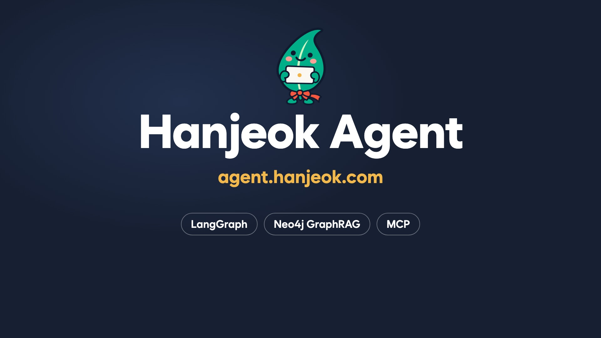
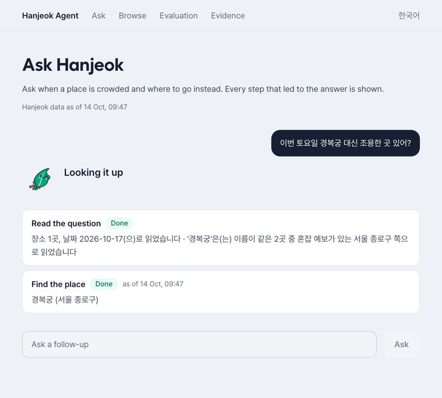
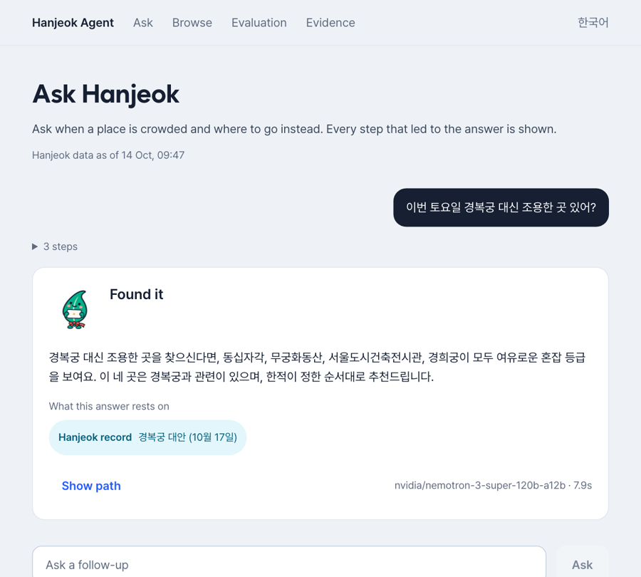
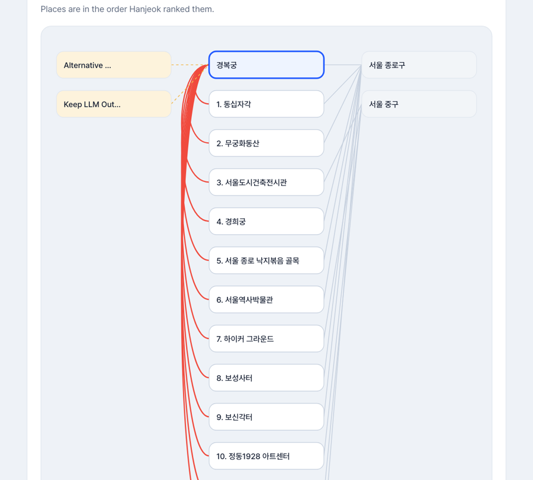
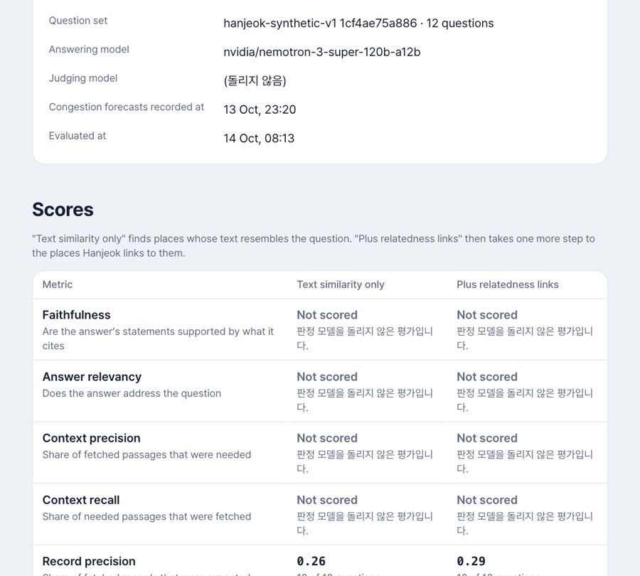
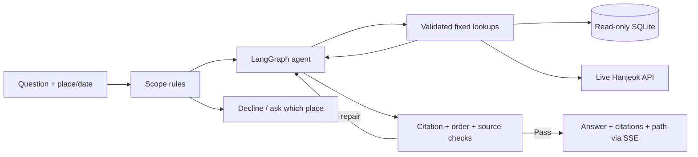
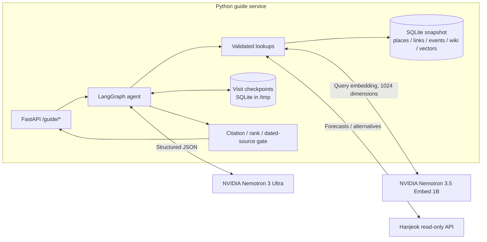
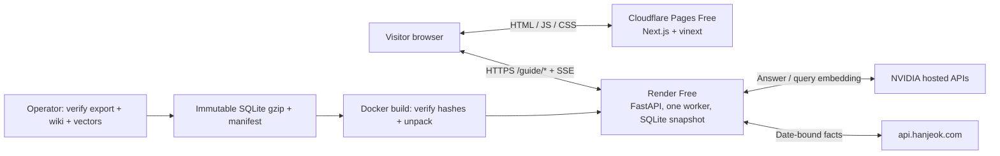

<div align="center">

<a href="https://agent.hanjeok.com"></a>

# 한적 에이전트

**어디가 붐비는지 묻고, 그 답이 어디에서 왔는지 봅니다.**

[한적](https://hanjeok.com) 서비스의 여행 안내 에이전트입니다. 찾아보는 단계를 화면에 보여 주고,<br/>
그 질문에서 실제로 가져온 것만 인용해 답합니다.

[English](./README.md) · **한국어** · [日本語](./README.ja.md) · [中文](./README.zh.md)

[](https://agent.hanjeok.com/ko/ask)


</div>

<br/>

<div align="center">

<a href="docs/media/hanjeok-guide.mp4"></a>

<sub>이전 배포에서 촬영한 20초 데모입니다. 현재 구조와 검증 결과는 아래 문서를 참고하세요.</sub>

</div>

<br/>

## 🧭 어떤 질문에 답하나

"이번 토요일 경복궁 대신 조용한 곳 있어?"

검색창으로는 답할 수 없는 질문입니다. 장소를 찾고, 그 날짜의 혼잡 예보를 확인하고, 서비스가 그 장소에 매긴 대안 순위를 받아야 합니다. 세 가지를 차례로 해야 하고, 답을 받고 나면 질문이 하나 더 남습니다. **그걸 누가 그렇다고 했나?**

| 데이터베이스 위에 얹은 챗봇 | 한적 에이전트 |
| :-- | :-- |
| 모델이 답을 쓰고 사용자는 믿는다 | 거친 단계가 전부 화면에 있고, 단계마다 무엇을 가져왔는지 보인다 |
| 모델이 그럴듯한 것을 고른다 | 순위는 서비스가 정하고, 모델은 순서를 바꾸거나 고르지 않는다 |
| 매끄러운 답이 아무 근거 없이 나올 수 있다 | 이번 질문에서 가져온 것만 인용할 수 있고, 아니면 답을 보여 주지 않는다 |
| "데이터 없음"이 슬그머니 "괜찮을 것"이 된다 | 예보가 없는 장소는 모른다고 말하고, 한적하다고 말하지 않는다 |

<br/>

## ✨ 할 수 있는 것

<table>
  <tr>
    <td width="52%" valign="top"></td>
    <td valign="top">

### 묻고, 찾아보는 과정을 본다

- 장소와 날짜를 넣어 평소 말하듯 묻습니다.
- 질문은 **규칙으로 먼저** 읽습니다. 어느 장소인지, 어느 날짜인지, 답할 수 있는 질문인지를 여기서 정하고, 이 단계에서는 모델을 부르지 않습니다.
- 조회가 끝날 때마다 단계가 하나씩 나타납니다. 거절된 조회도 이유와 함께 보입니다.

</td>
  </tr>
  <tr>
    <td valign="top"></td>
    <td valign="top">

### 확인할 수 있는 답을 받는다

- 인용은 두 종류입니다. 사실은 **한적 레코드**가, 한적이 그 사실을 왜 그렇게 다루는지는 **정책 문서**가 뒷받침합니다.
- 답은 보여 주기 전에 검사합니다. 이번 질문에서 가져오지 않은 것을 인용하면 통과하지 못하고, 한 번 고쳐 쓰게 한 뒤에도 실패하면 아무것도 보여 주지 않습니다.
- 요금, 운영 시간, "순위를 바꿔 줘" 같은 요청은 거절하고, 대신 무엇을 물을 수 있는지 알려 줍니다.

</td>
  </tr>
  <tr>
    <td valign="top"></td>
    <td valign="top">

### 답이 지나온 경로를 본다

- 답이 거친 장소와 연결, 문서를 그림과 목록으로 봅니다.
- 대안은 **한적이 매긴 순위 그대로** 놓입니다. 화면이 다시 정렬하지 않습니다.
- 가져온 것만 그립니다. 그림을 채우려고 더하지 않습니다.

</td>
  </tr>
  <tr>
    <td valign="top"></td>
    <td valign="top">

### 얼마나 잘하는지 읽는다

- 같은 질문을 두 가지 검색 방식으로 풉니다. **글 유사도만** 쓰는 방식과 **연관 링크까지** 따라가는 방식입니다.
- 점수마다 몇 문항으로 계산했는지 붙어 있습니다.
- 계산하지 못한 점수는 이유와 함께 **"채점 못 함"**으로 적습니다. 0으로 적지 않습니다.

</td>
  </tr>
</table>

질문 없이 [장소의 이웃을 둘러볼](https://agent.hanjeok.com/ko/graph?place=10000028) 수도 있습니다.

<br/>

## ⚙️ 질문 하나가 처리되는 과정



그림의 어느 길로 가든 다섯 가지 규칙이 지켜집니다.

1. **모델은 쿼리를 쓰지 않습니다.** 조회 일곱 가지 중 하나를 고르고, 코드가 입력을 검증해 정해진 조회를 실행합니다.
2. **모델은 순위를 정하지 않습니다.** 목록은 한적의 순서대로 번호가 붙어 오고, 그 순서 그대로 전달됩니다.
3. **id를 짐작해서 장소에 닿을 수 없습니다.** 조회는 이번 질문에서 이미 찾은 장소만 받습니다.
4. **검증하지 않은 글은 화면에 나오지 않습니다.** 답은 한 글자씩 흘려보내지 않고, 인용 검사를 통과한 뒤 통째로 보냅니다.
5. **예산이 정해져 있습니다.** 조회 3번, 답 1번, 고쳐 쓰기 1번, 60초입니다.

<br/>

장소와 날짜가 하나로 확정된 대안 요청은 날짜별 대안 API를 사용하고 그 레코드를 인용해야 합니다. 장소 유사도 검색을 서비스의 대안 순위로 설명할 수 없습니다.

## 🏗 시스템 구조



**장소와 정책은 읽기 전용 SQLite, 날짜별 사실은 한적 API에서 가져옵니다.**
답변 모델과 질의 임베딩은 NVIDIA HTTP API로 호출합니다. 현재 공개 API 컨테이너에는
Neo4j 서버, 로컬 임베딩 모델과 모델 가중치가 없습니다.

- **미리 준비하는 데이터:** 공개 컬럼만 내보낸 JSONL과 manifest를 검증하고, 장소 및 고정 위키의 검증된 벡터를 SQLite로 묶습니다. 해시를 확인한 압축 파일을 이미지 빌드에서 해제하며, 갱신은 새 파일을 준비해 재배포합니다.
- **질문할 때 가져오는 데이터:** 혼잡 예보와 날짜별 대안은 한적의 읽기 전용 API에서 조회합니다. 조회수를 기록하는 장소 상세 API는 호출하지 않습니다. 에이전트에는 한적 운영 DB 접속 정보를 주지 않습니다.
- **검색과 상태:** `sqlite-vec`의 정확 코사인 검색과 고정 SQL을 사용합니다. LangGraph가 단계 전달과 되묻기를 처리하며, 대화 체크포인트는 `/tmp`의 별도 SQLite에 둡니다. 재시작하면 방문 상태와 사용 한도가 초기화됩니다.
- **호환 경로:** Neo4j 어댑터와 MCP CLI는 코드에 남아 있습니다. 현재 공개 프로필은 `GUIDE_STORE=sqlite`인 HTTP API이며, MCP 서버를 공개 포트로 띄우지는 않습니다.

[구현](bench/src/guide/sqlite_store.py) · [데이터 준비](bench/deploy/prepare_sqlite.py) · [기존 Cloud Run·Neo4j 구조와 README](docs/archive/guide-before-sqlite/README.ko.md)

<br/>

## ☁️ 배포 구조



| 구분 | 현재 구성 |
| :-- | :-- |
| 공개 화면 | [agent.hanjeok.com](https://agent.hanjeok.com/ko/ask), Cloudflare Pages Free |
| 안내 API | [hanjeok-guide.onrender.com](https://hanjeok-guide.onrender.com/guide/ready), Render Free |
| 실행 단위 | Python 3.13, FastAPI, uvicorn 워커 1개, 동시 질문 1개 |
| 데이터 | 이미지에 포함한 읽기 전용 SQLite, 외부 DB 인증 불필요 |
| 모델 시크릿 | 기존 `NVIDIA_API_KEY`를 Render 환경 변수로 주입 |
| 준비 확인 | `/guide/ready`는 파일 무결성·스키마·건수·벡터 식별자 검증 후 200; 제공자 가용성은 실제 질문으로 별도 확인 |
| 프론트 연결 | `NEXT_PUBLIC_GUIDE_BASE_URL`을 새 API 주소로 지정하고 재빌드; 브라우저가 API에 직접 SSE 요청 |

2026-11-24 배포와 공개 화면의 실제 AI 답변을 확인했습니다. Render는 작업 브랜치의
지정 커밋을 수동 배포합니다. Pages의 `--branch main`은 운영 배포 라벨이며 Git main 병합을 뜻하지 않습니다.

[현재 배포 방법](docs/deploy.md) · [512MiB 설정과 데이터 갱신](deployment/guide-free/README.md) · [배포 검증 기록](bench/reports/runtime/sqlite-deployment.json) · [이전 배포 안내](docs/archive/guide-before-sqlite/deploy.md)

<br/>

## 📊 지금까지 잰 것

2026-11-24에 확인한 현재 배포 기준입니다.

| 항목 | 관측 결과 |
| :-- | :-- |
| 데이터 | 2026-11-23 export: 장소 12,106개, 연관 관계 43,087개, 행사 209개, 지역 229개 |
| 위키 | 고정 revision `7fc19c0`, 18문서 / 83청크 |
| 기본 테스트 | 백엔드 525개 통과, 통합·실제 모델 검사 43개 제외; 프론트 296개 통과 |
| 512MiB 검사 | 최종 이미지의 로컬 amd64 에뮬레이션에서 최대 297.7MiB(20ms 표본), 스왑 0, OOM 0. Render 자체 메모리 측정값은 아님 |
| 실제 공개 화면 | 경복궁 예보 질문의 AI 답변과 원본 인용, Ultra 모델 표시를 확인. 한 번 관측한 응답 시간은 7.6초 |
| 실응답 검사 | 공개 예보·정책은 원본 조회/인용 검사 통과. 대안은 올바른 API 조회 후 모델 호출 실패가 남아 전체 smoke는 `passed=false` |

**현재 SQLite 구성의 전체 60문항 품질 평가는 아직 실행하지 않았습니다.**
기존 Neo4j/E5 및 다른 모델의 점수는 현재 구성의 성능으로 재사용하지 않습니다.
과거 평가 표와 당시 한계는 [이전 README](docs/archive/guide-before-sqlite/README.ko.md)에 보존했습니다.

[최종 메모리/실응답 기록](bench/reports/runtime/sqlite-512mb-source-guard-amd64.json) · [공개 SSE 기록](bench/reports/runtime/sqlite-public-sse-postguard.json) · [실제 화면](bench/reports/runtime/sqlite-public-forecast.jpg)

<br/>

## 🛠 기술 스택

| 영역 | 사용한 것 |
| :-- | :-- |
| 에이전트 | Python 3.13, FastAPI, LangGraph, LangChain |
| 현재 데이터와 검색 | 읽기 전용 SQLite, `sqlite-vec` 정확 코사인 검색, 고정 SQL |
| 답변 모델 | NVIDIA `nvidia/nemotron-3-ultra-550b-a55b`, 구조화 JSON 출력 |
| 질의 임베딩 | NVIDIA `nvidia/nemotron-3.5-embed-1b`, 1024차원, HTTP |
| 대화 상태 | LangGraph SQLite 체크포인트(`/tmp`), 메모리 방문/사용 한도 |
| 화면 | Next.js 16, React 19, Tailwind 4, vinext |
| 현재 배포 | Cloudflare Pages Free + Render Free, `bench/Dockerfile.api` |
| 별도 실험/연결 | Neo4j 어댑터, MCP CLI, 운영자 전용 평가와 RAGAS; 공개 API 프로세스에서 실행하지 않음 |
| 추적 | Langfuse, 키를 설정했을 때만 활성화 |

<br/>

## 🗂 저장소 둘러보기

| 경로 | 무엇인가 |
| :-- | :-- |
| [`bench/src/guide/`](bench/src/guide/) | 에이전트 본체. 범위 규칙, 조회, LangGraph 루프, 인용 검증, API, MCP 서버, 평가 |
| [`bench/tests/`](bench/tests/) | 단위, 계약, Neo4j 통합 테스트와 지어낸 장소로 만든 가상 내보내기 파일 |
| [`bench/Dockerfile.api`](bench/Dockerfile.api) · [`bench/deploy/`](bench/deploy/) | 현재 읽기 전용 SQLite API 이미지와 운영자 데이터 준비/검증 도구. 기존 `bench/Dockerfile`은 Neo4j 동거 구성으로 보존 |
| [`frontend/`](frontend/) | 화면 네 개와, 움직이는 구조도로 에이전트를 소개하는 홈 |
| [`specs/002-hanjeok-guide-agent/`](specs/002-hanjeok-guide-agent/) | 명세, 조사한 결정, 데이터 모델, 계약, 작업 목록 |
| [`docs/prd/`](docs/prd/hanjeok-guide-agent.md) | 제품 요구사항 |
| [`docs/deploy.md`](docs/deploy.md) | 현재 Render/Cloudflare 배포와 이전 배포 기록 링크 |
| [`server/`](server/) | 앞서 만든 코스 설명기 (Kotlin, Spring AI). 아래 참고 |

### 핵심 생각을 코드에서 읽을 곳

- [`scope.py`](bench/src/guide/scope.py): 모델을 부르기 전에 질문에 대해 정하는 것
- [`lookups.py`](bench/src/guide/lookups.py): 조회 일곱 가지와 각각이 거절하는 것
- [`agent.py`](bench/src/guide/agent.py): LangGraph 루프, 멈췄다 이어 가기, 예산
- [`citations.py`](bench/src/guide/citations.py): 인용 검증
- [`export.py`](bench/src/guide/export.py): 목록 파일과 다른 내보내기 파일을 거절하기
- [`forbidden.py`](bench/src/guide/forbidden.py): 규칙으로 세는 금지 행동 여덟 가지

<br/>

## 🚀 로컬에서 실행하기

화면만 띄워 녹화한 응답을 재생합니다. Node 22와 pnpm이 필요합니다.

```bash
cd frontend
pnpm install
pnpm dev          # http://localhost:3000/ko/ask
```

현재 배포와 같은 SQLite API는 저장소 루트에서 아래처럼 실행합니다. 먼저 [환경 변수 예시](deployment/guide-free/env.example)를 저장소 밖에 복사해 NVIDIA 키와 로컬 CORS 오리진을 설정합니다.

```bash
docker build -f bench/Dockerfile.api -t hanjeok-guide:api bench
docker run --rm --memory 512m --memory-swap 512m --cpus 1 \
  --env-file /path/outside-repository/guide.env -e GUIDE_STORE=sqlite \
  -p 127.0.0.1:8090:8000 hanjeok-guide:api
```

기존 Neo4j 어댑터를 가상 데이터로 실행하는 방법도 유지합니다. Python 3.13, uv, Docker가 필요합니다.

```bash
cd bench
docker compose up -d
uv sync
uv run guide refresh --export tests/fixtures/hanjeok-export
GUIDE_LIVE_MODE=replay uv run uvicorn guide.api:app --port 8090   # 답을 받으려면 NVIDIA_API_KEY 필요

uv run pytest                    # offline tests
uv run guide mcp                 # 같은 에이전트를 MCP로 (stdio)
```

화면을 서비스에 연결하려면 `NEXT_PUBLIC_GUIDE_BASE_URL=http://localhost:8090 pnpm dev`로 띄웁니다.

<br/>

## ⚠️ 알려진 한계

- **무료 서버는 유휴 상태에서 절전할 수 있습니다.** SQLite 전환 후 콜드 스타트 시간은 별도로 재측정하지 않았습니다.
- **실제 모델 호출 실패가 남아 있습니다.** 대안 조회가 성공해도 답변 생성이 실패할 수 있으며, 모든 실응답 검사를 통과한 상태는 아닙니다.
- **모델 키를 다른 프로젝트와 같이 씁니다.** 요청 한도에 걸리면 질문이 느려지거나 실패합니다.
- **두 글자 장소 이름은 보수적으로 읽습니다.** 그래도 "지도에서 가까운 곳"의 "지도"는 섬 지도로 읽힙니다.
- **방문 기록과 사용 한도는 메모리에 있습니다.** 그래서 서비스를 인스턴스 하나로 돌립니다.
- **안내 캐릭터 이미지**는 Codex 이미지 생성으로 만들었습니다. 상표 검토와 AI 생성 이미지 저작권 검토를 하지 않았고, 작성자가 2026-10-14에 공개를 결정했습니다. 기록은 [`provenance.json`](design/guide-character/v1/provenance.json)에 있습니다. 홈의 소개 그림과 구조도에서 움직이는 잎새 그림 두 장도 같은 방법으로 만들었고 역시 검토하지 않았습니다. 기록은 [`design/home-intro/v1/`](design/home-intro/v1/)와 [`design/agent-flow/v1/`](design/agent-flow/v1/)에 있습니다.
- **구조도의 기술 로고**는 각 회사의 상표입니다. 어디서 무엇이 도는지 보여 주려고 [simple-icons](https://simple-icons.org)(CC0)의 공식 마크를 바꾸지 않고 썼습니다.

<br/>

## 📚 앞서 만든 것: 코스 설명기

안내 에이전트 이전에 이 저장소는 한 가지만 설명했습니다. 한적 백엔드가 이미 만든 여행 코스를, 그 코스가 보이는 화면에서 설명하는 일입니다. Kotlin/Spring AI 코드와 당시 배포 기록은 보존하며, 이번 무료 이전 범위는 Python 안내 API입니다. 금지 행동 여덟 가지를 세는 하네스와 `gpt-4o`를 고른 모델 비교까지 담은 설명은 그대로 남겨 두었습니다.

**[코스 설명기 README →](docs/explainer/README.ko.md)** · [English](docs/explainer/README.md)

<br/>

## 👤 만든 사람

<div align="center">

|  |
| :---: |
| [hyunolike](https://github.com/hyunolike) |

</div>

2026년 오픈소스 AI 자동화 에이전트 풀스택 과정의 프로젝트로 만들었습니다. 남은 일은 [이슈](https://github.com/hyunolike/hanjeok-agent/issues)에서 관리합니다.

## 📄 라이선스

[MIT](LICENSE) — © 2026 hyunolike.
