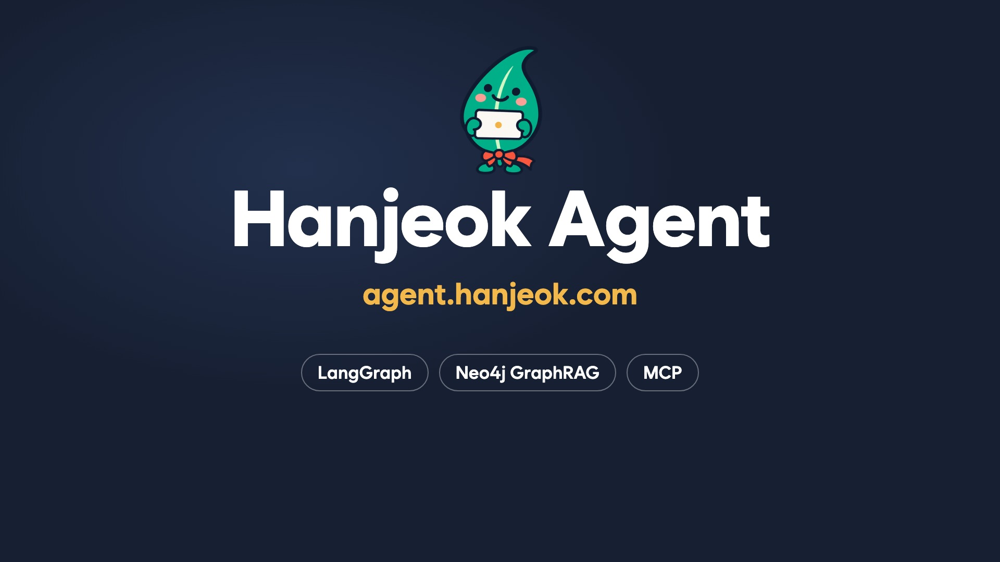
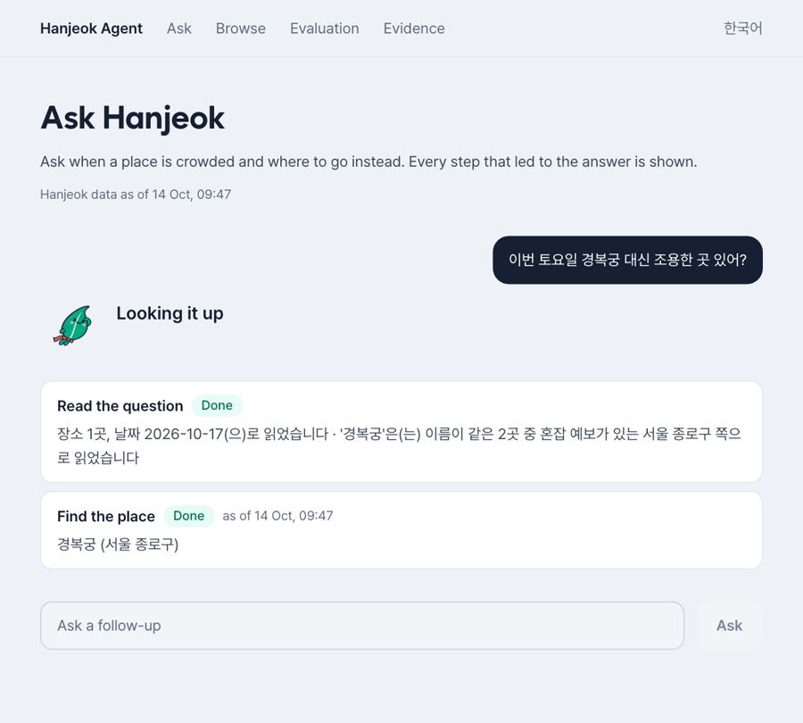
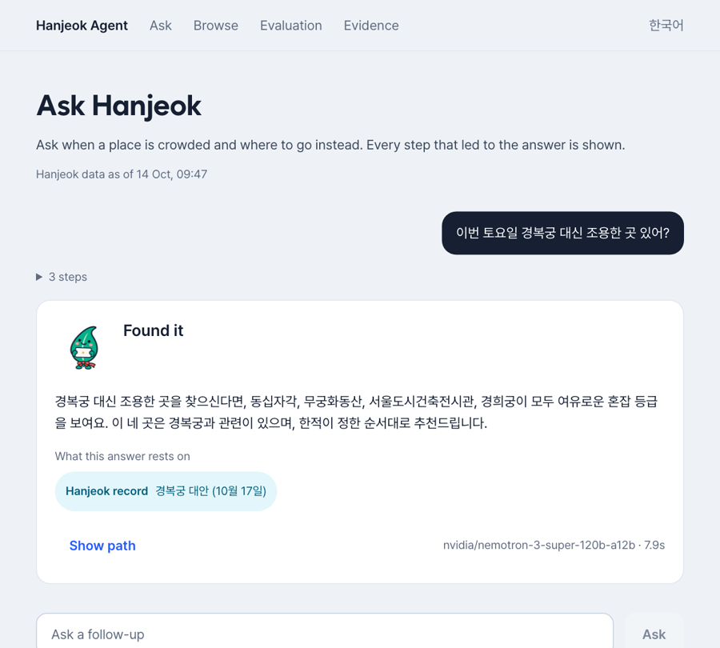
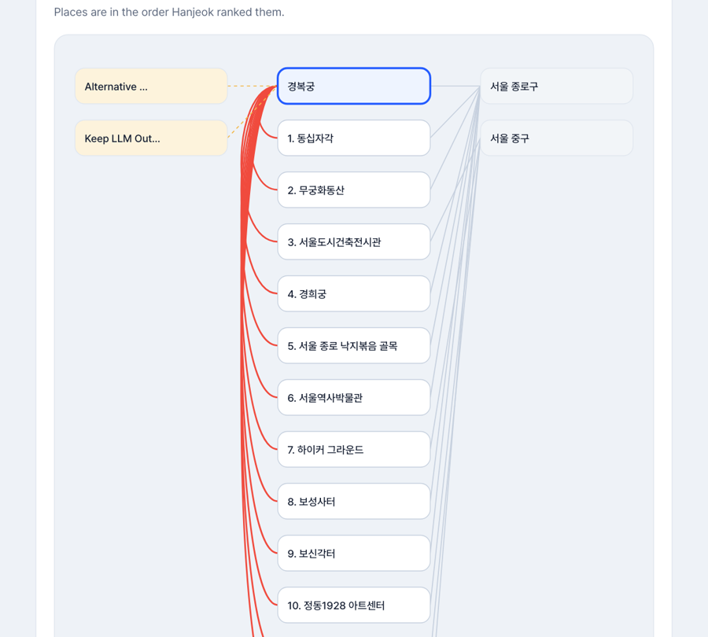
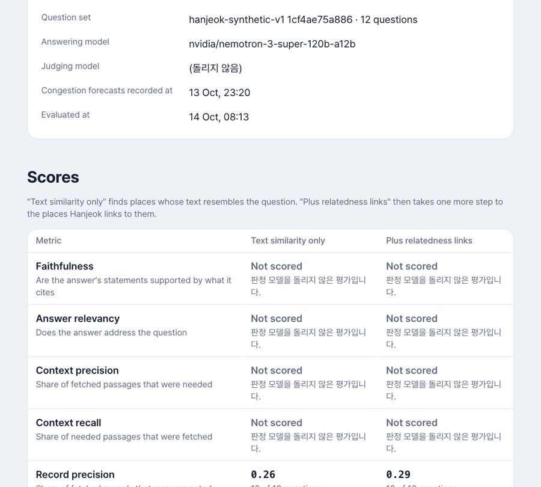
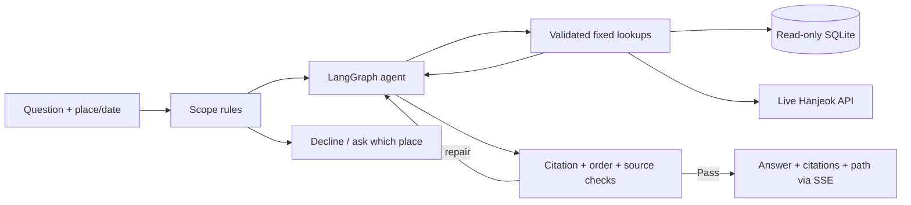
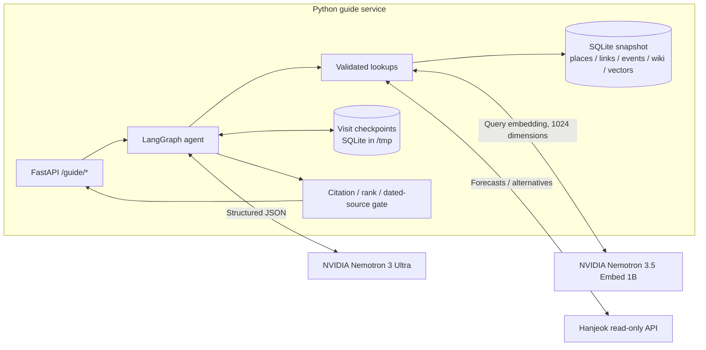
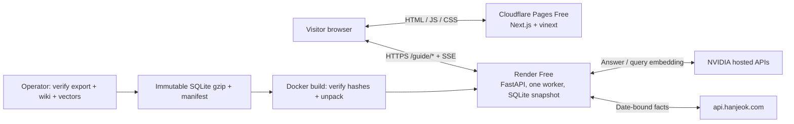

<div align="center">

<a href="https://agent.hanjeok.com"></a>

# Hanjeok Agent

**Ask where it's crowded. See where the answer came from.**

A travel guide agent for the [Hanjeok](https://hanjeok.com) service. It looks things up in steps you can watch,<br/>
and answers citing only what it fetched for your question.

**English** · [한국어](./README.ko.md) · [日本語](./README.ja.md) · [中文](./README.zh.md)

[](https://agent.hanjeok.com/en/ask)


</div>

<br/>

<div align="center">

<a href="docs/media/hanjeok-guide.mp4"></a>

<sub>A 20-second recording from the previous deployment. Current architecture and verification are documented below.</sub>

</div>

<br/>

## 🧭 The question this answers

"Somewhere quiet instead of Gyeongbokgung this Saturday?"

A search box cannot answer that. It takes three things in a row: find the place, check how crowded it is forecast to be on that date, then ask which alternatives the service ranks for it. And once an answer comes back, a second question follows: **who says so?**

| A chat box over a database | Hanjeok Agent |
| :-- | :-- |
| The model writes an answer and you take its word | Every step it took is on screen, with what each one fetched |
| The model picks what sounds good | The service ranks; the model never reorders or chooses |
| A fluent answer may rest on nothing | An answer may cite only what this question fetched, or it is not shown |
| "No data" quietly becomes "probably fine" | A place with no forecast is reported as unknown, never as quiet |

<br/>

## ✨ What you can do

<table>
  <tr>
    <td width="52%" valign="top"></td>
    <td valign="top">

### Ask, and watch it work

- Ask in your own words, with a place and a date.
- The question is read **by rule first**: which place, which date, and whether it is something the agent answers at all. No model is called for that.
- Each lookup appears as it finishes. A lookup that was refused is shown too, with the reason.

</td>
  </tr>
  <tr>
    <td valign="top"></td>
    <td valign="top">

### Get an answer you can check

- Citations come in two kinds: a **Hanjeok record** for a fact, a **policy document** for why the service treats it that way.
- An answer is checked before it is shown. Citing something that was not fetched for this question fails the check; after one repair attempt, nothing is shown.
- Prices, opening hours and "reorder the ranking for me" are declined, with a sentence saying what can be asked instead.

</td>
  </tr>
  <tr>
    <td valign="top"></td>
    <td valign="top">

### See the path it took

- The places, links and documents the answer touched, as a drawing and as a list.
- Alternatives are **in the order Hanjeok ranked them**. The screen does not re-sort.
- It shows exactly what was fetched. Nothing is added to make the picture fuller.

</td>
  </tr>
  <tr>
    <td valign="top"></td>
    <td valign="top">

### Read how well it does

- Two retrieval strategies answer the same questions: **text similarity only**, and **plus relatedness links**.
- Every score carries the number of questions behind it.
- A score that could not be computed says **"Not scored"** and why. It is never a zero.

</td>
  </tr>
</table>

Also: [browse a place's neighbours](https://agent.hanjeok.com/en/graph?place=10000028) without asking anything.

<br/>

## ⚙️ How one question is handled



Five rules hold across every path through that picture.

1. **The model does not write queries.** It picks one of seven lookups; code validates the inputs and runs a fixed read.
2. **The model does not rank.** Lists arrive numbered in Hanjeok's order and are passed on in that order.
3. **A place cannot be reached by guessing its id.** A lookup accepts only places this question has already found.
4. **Unverified text never reaches the screen.** The answer is sent whole, after the citation check, not streamed token by token.
5. **The budget is fixed.** Three lookup rounds, one answer, one repair, sixty seconds.

<br/>

An unambiguous single-place, single-date replacement request uses the dated alternatives API and must cite that fetched record. Semantic place search cannot stand in for the service’s alternative ranking.

## 🏗 System architecture



**Places and policy live in a read-only SQLite snapshot; date-bound facts come from Hanjeok's API.**
Answer generation and query embeddings use NVIDIA HTTP APIs. The public API container carries no Neo4j server, local embedding model or model weights.

- **Prepared before deployment:** validate the public-column JSONL export and manifest, then package the places, pinned wiki and verified vectors into SQLite. The image build verifies and unpacks the snapshot. Updates require a new artifact and deployment.
- **Fetched for each question:** read-only Hanjeok endpoints supply forecasts and dated alternatives. The place-detail endpoint is not called because it records views. The agent receives no credentials to Hanjeok's production DB.
- **Search and state:** `sqlite-vec` performs exact cosine search through fixed SQL. LangGraph carries steps and clarification pauses; a separate SQLite file in `/tmp` holds checkpoints. Visits and usage limits reset with the process.
- **Other adapters remain available:** Neo4j and the MCP CLI are retained. The deployed profile is the HTTP API with `GUIDE_STORE=sqlite`; it does not expose an MCP server port.

[Implementation](bench/src/guide/sqlite_store.py) · [Artifact preparation](bench/deploy/prepare_sqlite.py) · [Previous Cloud Run/Neo4j architecture and README](docs/archive/guide-before-sqlite/README.md)

<br/>

## ☁️ Deployment architecture



| Part | Deployed configuration |
| :-- | :-- |
| Screens | [agent.hanjeok.com](https://agent.hanjeok.com/en/ask), Cloudflare Pages Free |
| Guide API | [hanjeok-guide.onrender.com](https://hanjeok-guide.onrender.com/guide/ready), Render Free |
| Process | Python 3.13, FastAPI, one uvicorn worker, one concurrent question |
| Data | Read-only SQLite bundled in the image; no external DB credentials |
| Model secret | Existing `NVIDIA_API_KEY` supplied through Render environment variables |
| Readiness | `/guide/ready` returns 200 after file/schema/count/vector-identity validation; provider availability needs a real question |
| Browser connection | Rebuild with `NEXT_PUBLIC_GUIDE_BASE_URL`; the browser sends SSE requests directly to the API |

Deployment and a real browser answer were verified on 2026-11-24. Render deploys a specified feature-branch commit manually. Pages `--branch main` selects the production environment; it does not merge Git main.

[Current deployment guide](docs/deploy.md) · [512MiB profile and data updates](deployment/guide-free/README.md) · [Deployment evidence](bench/reports/runtime/sqlite-deployment.json) · [Previous deployment guide](docs/archive/guide-before-sqlite/deploy.md)

<br/>

## 📊 What has been measured

Observed for the deployed profile on 2026-11-24.

| Item | Evidence |
| :-- | :-- |
| Data | 2026-11-23 export: 12,106 places, 43,087 related links, 209 events, 229 regions |
| Wiki | Pinned revision `7fc19c0`, 18 documents / 83 chunks |
| Default tests | 525 backend passed, 43 integration/real-model checks deselected; 296 frontend passed |
| 512MiB check | Final image: 297.7MiB sampled peak at 20ms, no swap or OOM, local amd64 emulation. This is not a native Render memory measurement |
| Public browser | Gyeongbokgung forecast answer, original record citation and Ultra model visible; 7.6 seconds in one observed question |
| Live probes | Public forecast/policy source checks passed. Alternatives reached the correct API but model generation failed, so the complete smoke remains `passed=false` |

**The full 60-question quality evaluation has not been run for SQLite.** Previous Neo4j/E5 and other-model scores are not reused as this profile's results. The old score table and its limitations remain in the [previous README](docs/archive/guide-before-sqlite/README.md).

[Final memory/live probe](bench/reports/runtime/sqlite-512mb-source-guard-amd64.json) · [Public SSE evidence](bench/reports/runtime/sqlite-public-sse-postguard.json) · [Browser capture](bench/reports/runtime/sqlite-public-forecast.jpg)

<br/>

## 🛠 Tech stack

| Area | What is used |
| :-- | :-- |
| Agent | Python 3.13, FastAPI, LangGraph, LangChain |
| Deployed data/search | Read-only SQLite, `sqlite-vec` exact cosine search, fixed SQL |
| Answer model | NVIDIA `nvidia/nemotron-3-ultra-550b-a55b`, structured JSON |
| Query embedding | NVIDIA `nvidia/nemotron-3.5-embed-1b`, 1024 dimensions, HTTP |
| Visit state | LangGraph SQLite checkpoints in `/tmp`, in-memory visits and limits |
| Screens | Next.js 16, React 19, Tailwind 4, vinext |
| Deployment | Cloudflare Pages Free + Render Free, `bench/Dockerfile.api` |
| Separate tools/experiments | Neo4j adapter, MCP CLI, operator-only evaluation and RAGAS; not run in the public API process |
| Tracing | Langfuse, enabled only when keys are configured |

<br/>

## 🗂 Repository tour

| Path | What it is |
| :-- | :-- |
| [`bench/src/guide/`](bench/src/guide/) | The agent: scope rules, lookups, LangGraph loop, citation gate, API, MCP server, evaluation |
| [`bench/tests/`](bench/tests/) | Unit, contract and Neo4j integration tests; a synthetic export of invented places |
| [`bench/Dockerfile.api`](bench/Dockerfile.api) · [`bench/deploy/`](bench/deploy/) | Current read-only SQLite API image and operator preparation/checking tools; `bench/Dockerfile` retains the legacy Neo4j co-located image |
| [`frontend/`](frontend/) | The four screens, plus a home page that introduces the guide with an animated architecture diagram |
| [`specs/002-hanjeok-guide-agent/`](specs/002-hanjeok-guide-agent/) | Specification, research decisions, data model, contracts, tasks |
| [`docs/prd/`](docs/prd/hanjeok-guide-agent.md) | Product requirements (Korean) |
| [`docs/deploy.md`](docs/deploy.md) | Current Render/Cloudflare deployment and links to previous deployment records |
| [`server/`](server/) | The earlier course explainer (Kotlin, Spring AI) — see below |

### Where to read the core ideas in code

- [`scope.py`](bench/src/guide/scope.py) — what is decided about a question before any model is asked
- [`lookups.py`](bench/src/guide/lookups.py) — the seven lookups and what each refuses
- [`agent.py`](bench/src/guide/agent.py) — the LangGraph loop, the pause, the budgets
- [`citations.py`](bench/src/guide/citations.py) — the gate
- [`export.py`](bench/src/guide/export.py) — refusing an export that is not what its manifest says
- [`forbidden.py`](bench/src/guide/forbidden.py) — eight behaviours counted by rule

<br/>

## 🚀 Run it locally

Screens only, replaying recorded responses. Needs Node 22 and pnpm.

```bash
cd frontend
pnpm install
pnpm dev          # http://localhost:3000/en/ask
```

Run the deployed SQLite profile from the repository root. First copy the [environment template](deployment/guide-free/env.example) outside the repository and configure the NVIDIA key and local CORS origin.

```bash
docker build -f bench/Dockerfile.api -t hanjeok-guide:api bench
docker run --rm --memory 512m --memory-swap 512m --cpus 1 \
  --env-file /path/outside-repository/guide.env -e GUIDE_STORE=sqlite \
  -p 127.0.0.1:8090:8000 hanjeok-guide:api
```

The legacy Neo4j adapter can still run on the synthetic export. It needs Python 3.13, uv and Docker.

```bash
cd bench
docker compose up -d
uv sync
uv run guide refresh --export tests/fixtures/hanjeok-export
GUIDE_LIVE_MODE=replay uv run uvicorn guide.api:app --port 8090   # NVIDIA_API_KEY needed to answer

uv run pytest                    # offline tests
uv run guide mcp                 # the same agent over MCP (stdio)
```

Then point the screens at it: `NEXT_PUBLIC_GUIDE_BASE_URL=http://localhost:8090 pnpm dev`.

<br/>

## ⚠️ Known limits

- **Free instances can sleep while idle.** Cold-start time has not been remeasured for the SQLite profile.
- **Live model failures remain.** Alternative retrieval can succeed while answer generation fails; not every live probe passed.
- **The model key is shared with other projects.** A rate limit slows a question or fails it.
- **Two-character place names are matched conservatively.** "지도" (also an island) in "show me on the map" still reads as the island.
- **Visits and usage limits live in memory.** The service runs as one instance for that reason.
- **The guide character's images** were generated with Codex image generation. Trademark and AI-copyright review was not performed; the author released them on 2026-10-14. See [`provenance.json`](design/guide-character/v1/provenance.json). The home illustration and the two leaf pictures that move through the architecture diagram were made the same way and have not been reviewed either; records are in [`design/home-intro/v1/`](design/home-intro/v1/) and [`design/agent-flow/v1/`](design/agent-flow/v1/).
- **The technology logos in the diagram** are trademarks of their owners. They are the official marks from [simple-icons](https://simple-icons.org) (CC0), used unaltered to show what runs where.

<br/>

## 📚 The earlier component: course explainer

Before the guide agent, this repository explained one thing: a travel course the Hanjeok backend had already built, on the screen where it is shown. The Kotlin/Spring AI code and its deployment history remain; the current free migration covers the Python guide API and its write-up, with the harness that counts eight forbidden behaviours and the model comparison that picked `gpt-4o`, is kept in full:

**[Course explainer README →](docs/explainer/README.md)** · [한국어](docs/explainer/README.ko.md)

<br/>

## 👤 Author

<div align="center">

|  |
| :---: |
| [hyunolike](https://github.com/hyunolike) |

</div>

Built as the project for a full-stack open-source AI agent course (2026). Open follow-ups are tracked in [issues](https://github.com/hyunolike/hanjeok-agent/issues).

## 📄 License

[MIT](LICENSE) — © 2026 hyunolike.
