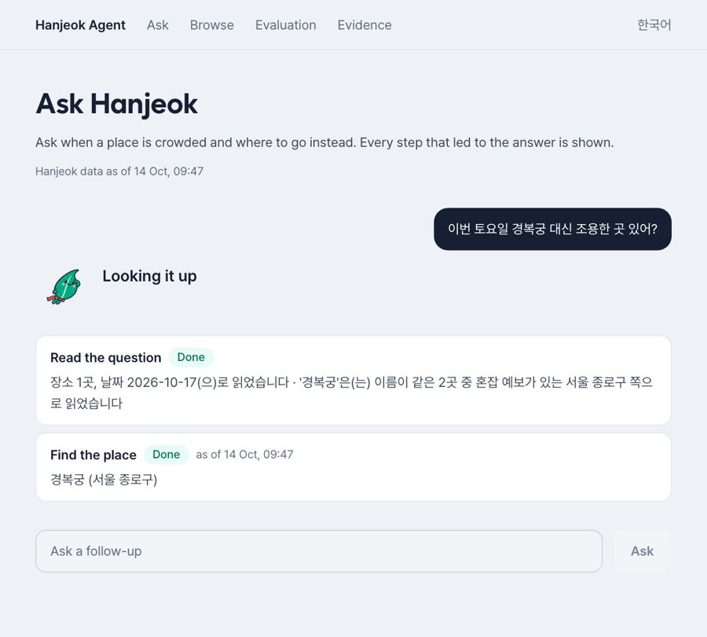
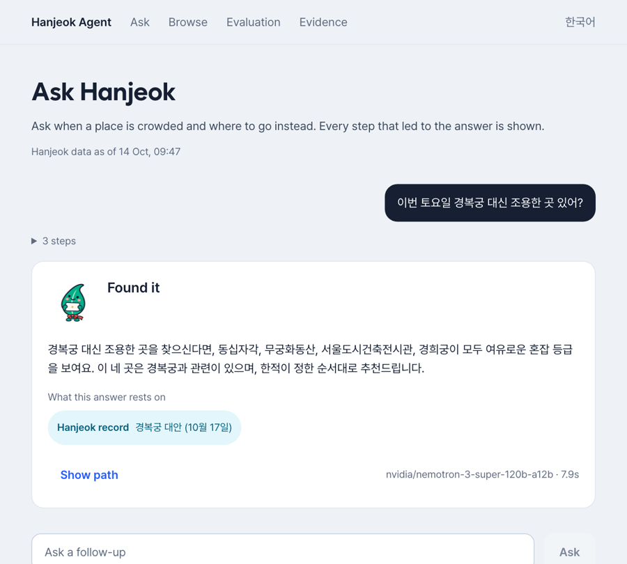
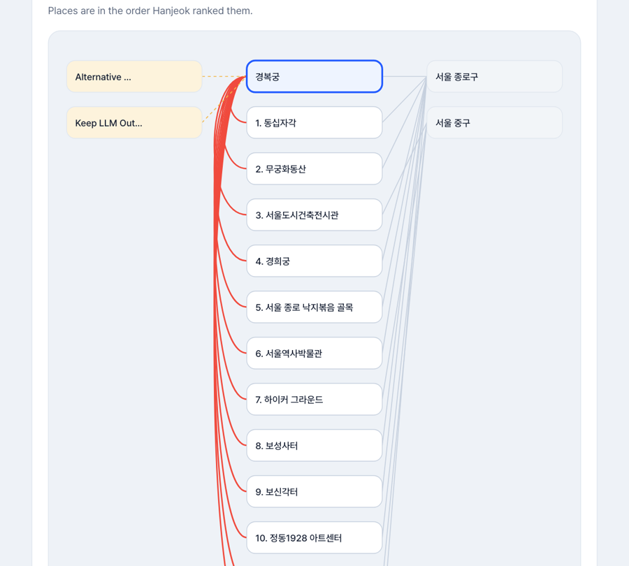
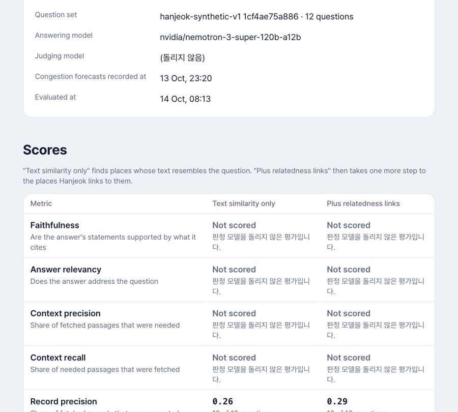
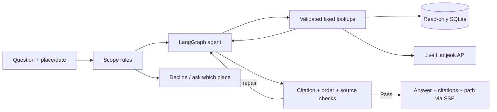
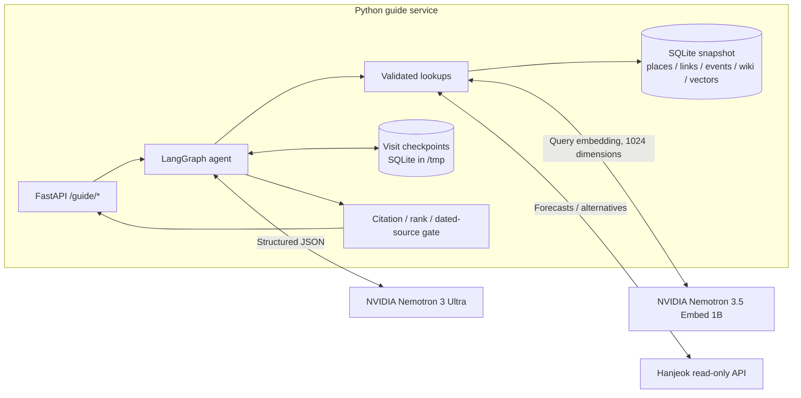
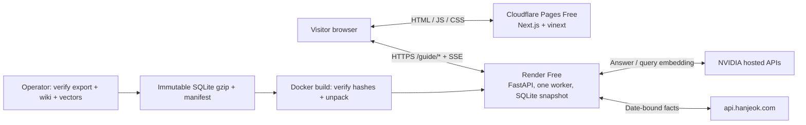

<div align="center">

<a href="https://agent.hanjeok.com"></a>

# Hanjeok Agent

**问哪里拥挤,也看到答案从何而来。**

旅行服务 [Hanjeok(韩寂)](https://hanjeok.com) 的导览智能体。它把查询的每一步展示在屏幕上,<br/>
并且只引用为这个问题实际取到的内容来回答。

[English](./README.md) · [한국어](./README.ko.md) · [日本語](./README.ja.md) · **中文**

[](https://agent.hanjeok.com/en/ask)


<sub>这是旧部署录制的20秒演示。当前架构与验证结果见下文。</sub>

</div>

<br/>

<div align="center">

<a href="docs/media/hanjeok-guide.mp4"></a>

<sub>20 秒,录自运行在真实 Hanjeok 数据上的线上站点。<b><a href="docs/media/hanjeok-guide.mp4">带声音观看 →</a></b></sub>

</div>

<br/>

## 🧭 它回答什么问题

"这周六不去景福宫,有没有安静一点的地方?"

搜索框答不了这个问题。它需要连续做三件事:找到地点,查看那一天的拥挤预报,再取得服务为该地点排出的替代地点。答案回来之后,还会剩下一个问题:**这是谁说的?**

| 架在数据库上的聊天框 | Hanjeok Agent |
| :-- | :-- |
| 模型写出答案,用户只能相信 | 走过的每一步都在屏幕上,并写明每一步取到了什么 |
| 模型挑选听起来不错的 | 排名由服务决定,模型既不重排也不挑选 |
| 流畅的答案可能毫无依据 | 只能引用本次问题取到的内容,否则不显示答案 |
| "没有数据"悄悄变成"大概没问题" | 没有预报的地点如实说不知道,绝不说它清静 |

<br/>

## ✨ 可以做什么

<table>
  <tr>
    <td width="52%" valign="top"></td>
    <td valign="top">

### 提问,并看它如何查找

- 带上地点和日期,用平常的话来问。
- 问题**先按规则**读取:是哪个地点、哪一天、是不是它能回答的问题。这一步不调用模型。
- 每完成一次查询就出现一个步骤。被拒绝的查询也会显示,并附上原因。

</td>
  </tr>
  <tr>
    <td valign="top"></td>
    <td valign="top">

### 得到可以核对的答案

- 引用分两种:事实由 **Hanjeok 记录**支撑,服务为何这样看待该事实由**政策文档**支撑。
- 答案在显示前要经过检查。引用了本次问题没有取到的内容就无法通过;允许重写一次,仍不通过则什么都不显示。
- 票价、营业时间、"帮我改一下排名"这类请求会被拒绝,并告诉你可以改问什么。

</td>
  </tr>
  <tr>
    <td valign="top"></td>
    <td valign="top">

### 查看答案走过的路径

- 以图和列表展示答案涉及的地点、关联和文档。
- 替代地点**按 Hanjeok 给出的排名**排列,界面不会重新排序。
- 只画取到的内容,不会为了让图更饱满而添加。

</td>
  </tr>
  <tr>
    <td valign="top"></td>
    <td valign="top">

### 读懂它答得怎么样

- 同一批问题用两种检索方式作答:**仅文本相似度**,以及**再沿关联链接走一步**。
- 每个分数都标明是由多少道题算出的。
- 算不出的分数写作**"Not scored"**并说明原因,绝不写成 0。

</td>
  </tr>
</table>

也可以不提问,直接[浏览某个地点的相邻地点](https://agent.hanjeok.com/en/graph?place=10000028)。

<br/>

## ⚙️ 一个问题是怎样被处理的



无论走图中的哪条路,都遵守五条规则。

1. **模型不写查询语句。** 它从七种查询中选一种,由代码校验输入并执行固定的读取。
2. **模型不做排名。** 列表按 Hanjeok 的顺序带编号送达,并按原顺序传递。
3. **无法靠猜 ID 触达某个地点。** 查询只接受本次问题已经找到的地点。
4. **未经验证的文字不会出现在屏幕上。** 答案不逐字流出,而是通过引用检查后整体发送。
5. **预算是固定的。** 查询 3 轮、回答 1 次、重写 1 次,共 60 秒。

<br/>

对于已明确单个地点与日期的替代地点请求，必须查询并引用当日替代地点 API 的记录。不能把地点相似检索结果描述成服务的替代排名。

## 🏗 系统架构



**地点和政策保存在只读 SQLite 中，按日期变化的事实来自 Hanjeok API。** 回答生成与查询嵌入使用 NVIDIA HTTP API。公开 API 容器不包含 Neo4j 服务器、本地模型或模型权重。

- **部署前准备：** 校验仅含公开列的 JSONL 与 manifest，将地点、固定版本 wiki 和验证过的向量打包为 SQLite。镜像构建时校验哈希并解压。更新数据需要生成新文件并重新部署。
- **提问时查询：** 拥挤预报与当日替代地点来自只读 API。不调用会记录浏览量的地点详情接口，也不持有 Hanjeok 生产数据库凭据。
- **检索与状态：** 使用 `sqlite-vec` 精确余弦检索和固定 SQL。LangGraph 处理步骤与反问，检查点保存在 `/tmp` 的独立 SQLite 中。访问状态和用量上限随进程重启清空。
- **保留的接口：** Neo4j 适配器和 MCP CLI 仍在代码中。公开配置是 `GUIDE_STORE=sqlite` 的 HTTP API，不开放 MCP 服务器端口。

[实现](bench/src/guide/sqlite_store.py) · [数据准备](bench/deploy/prepare_sqlite.py) · [旧架构与 README](docs/archive/guide-before-sqlite/README.zh.md)

<br/>

## ☁️ 部署结构



| 部分 | 当前配置 |
| :-- | :-- |
| 界面 | [agent.hanjeok.com](https://agent.hanjeok.com/en/ask)，Cloudflare Pages Free |
| API | [hanjeok-guide.onrender.com](https://hanjeok-guide.onrender.com/guide/ready)，Render Free |
| 进程 | Python 3.13、FastAPI、一个 uvicorn worker、一个并发问题 |
| 数据 | 镜像内的只读 SQLite，无需外部数据库凭据 |
| 密钥 | 通过 Render 环境变量注入现有 `NVIDIA_API_KEY` |
| 就绪检查 | `/guide/ready` 校验文件、schema、数量与向量标识后返回200；模型可用性需用真实问题另行确认 |
| 浏览器连接 | 设置 `NEXT_PUBLIC_GUIDE_BASE_URL` 后重新构建，浏览器直接向 API 发起 SSE 请求 |

2026-11-24 已验证公开部署及真实浏览器回答。Render 手动部署工作分支的指定提交。Pages 的 `--branch main` 是生产环境标签，不代表合并 Git main。

[当前部署说明](docs/deploy.md) · [512MiB 配置与数据更新](deployment/guide-free/README.md) · [验证记录](bench/reports/runtime/sqlite-deployment.json) · [旧部署说明](docs/archive/guide-before-sqlite/deploy.md)

<br/>

## 📊 目前测量过的内容

以下为2026-11-24确认的当前部署结果。

| 项目 | 观测结果 |
| :-- | :-- |
| 数据 | 2026-11-23 export：12,106个地点、43,087条关联、209个活动、229个地区 |
| Wiki | 固定 revision `7fc19c0`，18篇文档 / 83个分块 |
| 默认测试 | 后端525项通过，排除43项集成/真实模型检查；前端296项通过 |
| 512MiB 检查 | 最终镜像在本地 amd64 模拟中以20ms采样，峰值297.7MiB，无 swap/OOM；不是 Render 原生测量 |
| 公开浏览器 | 已看到景福宫预报的真实回答、原始记录引用和 Ultra 模型标识；单次观察为7.6秒 |
| 真实请求 | 公开预报/政策通过来源与引用检查；替代地点在正确 API 查询后出现模型调用失败，整体 smoke 保留 `passed=false` |

**SQLite 配置尚未运行完整60题质量评估。** 不将旧 Neo4j/E5 或其他模型分数当作当前结果。旧评估表和限制保存在[旧 README](docs/archive/guide-before-sqlite/README.zh.md)。

[内存与真实请求](bench/reports/runtime/sqlite-512mb-source-guard-amd64.json) · [公开 SSE](bench/reports/runtime/sqlite-public-sse-postguard.json) · [实际界面](bench/reports/runtime/sqlite-public-forecast.jpg)

<br/>

## 🛠 技术栈

| 领域 | 技术 |
| :-- | :-- |
| 智能体 | Python 3.13、FastAPI、LangGraph、LangChain |
| 当前数据与检索 | 只读 SQLite、`sqlite-vec` 精确余弦检索、固定 SQL |
| 回答模型 | NVIDIA `nvidia/nemotron-3-ultra-550b-a55b`，结构化 JSON |
| 查询嵌入 | NVIDIA `nvidia/nemotron-3.5-embed-1b`，1024维，HTTP |
| 访问状态 | `/tmp` 中的 LangGraph SQLite 检查点，内存中的访问与用量限制 |
| 界面 | Next.js 16、React 19、Tailwind 4、vinext |
| 部署 | Cloudflare Pages Free + Render Free，`bench/Dockerfile.api` |
| 独立工具与实验 | Neo4j 适配器、MCP CLI、运维评估和 RAGAS，不在公开 API 进程内运行 |
| 追踪 | 配置密钥后才启用 Langfuse |

<br/>

## 🗂 仓库导览

| 路径 | 内容 |
| :-- | :-- |
| [`bench/src/guide/`](bench/src/guide/) | 智能体本体:范围规则、查询、LangGraph 循环、引用关卡、API、MCP 服务器、评估 |
| [`bench/tests/`](bench/tests/) | 单元、契约与 Neo4j 集成测试,以及用虚构地点制作的合成导出文件 |
| [`bench/Dockerfile.api`](bench/Dockerfile.api) · [`bench/deploy/`](bench/deploy/) | 当前只读 SQLite API 镜像及数据准备/验证工具；`bench/Dockerfile` 保留旧 Neo4j 同容器配置 |
| [`frontend/`](frontend/) | 四个界面,以及用动态架构图介绍代理的首页 |
| [`specs/002-hanjeok-guide-agent/`](specs/002-hanjeok-guide-agent/) | 规格、调研决策、数据模型、契约、任务 |
| [`docs/prd/`](docs/prd/hanjeok-guide-agent.md) | 产品需求(韩语) |
| [`docs/deploy.md`](docs/deploy.md) | 当前 Render/Cloudflare 部署及旧部署记录链接 |
| [`server/`](server/) | 早先的行程解说服务(Kotlin、Spring AI),见下文 |

### 在代码中阅读核心思路

- [`scope.py`](bench/src/guide/scope.py):调用模型之前对问题所做的判断
- [`lookups.py`](bench/src/guide/lookups.py):七种查询及各自拒绝的情况
- [`agent.py`](bench/src/guide/agent.py):LangGraph 循环、暂停、预算
- [`citations.py`](bench/src/guide/citations.py):引用关卡
- [`export.py`](bench/src/guide/export.py):拒绝与清单不符的导出文件
- [`forbidden.py`](bench/src/guide/forbidden.py):按规则统计的八种禁止行为

<br/>

## 🚀 在本地运行

只启动界面,回放预先录制的响应。需要 Node 22 和 pnpm。

```bash
cd frontend
pnpm install
pnpm dev          # http://localhost:3000/en/ask
```

从仓库根目录运行当前 SQLite API。先将[环境变量示例](deployment/guide-free/env.example)复制到仓库之外，并配置 NVIDIA 密钥及本地 CORS origin。

```bash
docker build -f bench/Dockerfile.api -t hanjeok-guide:api bench
docker run --rm --memory 512m --memory-swap 512m --cpus 1 \
  --env-file /path/outside-repository/guide.env -e GUIDE_STORE=sqlite \
  -p 127.0.0.1:8090:8000 hanjeok-guide:api
```

也保留了用合成数据运行旧 Neo4j 适配器的方法，需要 Python 3.13、uv 和 Docker。

```bash
cd bench
docker compose up -d
uv sync
uv run guide refresh --export tests/fixtures/hanjeok-export
GUIDE_LIVE_MODE=replay uv run uvicorn guide.api:app --port 8090   # 回答需要 NVIDIA_API_KEY

uv run pytest                    # offline tests
uv run guide mcp                 # 以 MCP 方式提供同一个智能体(stdio)
```

要让界面连接服务,请用 `NEXT_PUBLIC_GUIDE_BASE_URL=http://localhost:8090 pnpm dev` 启动。

<br/>

## ⚠️ 已知限制

- **免费实例可能在空闲时休眠。** SQLite 迁移后的冷启动时间尚未重新测量。
- **真实模型调用仍有失败。** 替代地点查询成功后也可能生成失败，并非所有真实请求检查都通过。
- **模型密钥与其他项目共用。** 遇到限流时,提问会变慢或失败。
- **两个字的地名采用保守匹配。** 即便如此,"在地图上离得近的地方"里的"지도(地图)"仍会被读成同名的岛屿。
- **访问记录和用量上限保存在内存中。** 因此服务只运行一个实例。
- **导览角色的图片**由 Codex 图像生成制作。未进行商标和 AI 生成图像的版权审查,作者于 2026-10-14 决定公开。记录见 [`provenance.json`](design/guide-character/v1/provenance.json)。首页的介绍插图和架构图中移动的两张叶子图片也以同样方式制作,同样未经审查,记录见 [`design/home-intro/v1/`](design/home-intro/v1/) 和 [`design/agent-flow/v1/`](design/agent-flow/v1/)。
- **架构图中的技术标志**是各公司的商标。为了说明各部分在哪里运行,原样使用了 [simple-icons](https://simple-icons.org)(CC0)的官方标志。

<br/>

## 📚 早先的组成部分:行程解说服务

在导览智能体之前,本仓库只解说一件事:Hanjeok 后端已经生成的旅行行程,就在显示该行程的界面上解说。Kotlin/Spring AI 代码和当时的部署记录仍然保留；本次免费迁移仅覆盖 Python 导览 API。其完整说明,包括统计八种禁止行为的测试框架以及最终选定 `gpt-4o` 的模型对比,均原样保留。

**[行程解说服务 README →](docs/explainer/README.md)** · [한국어](docs/explainer/README.ko.md)

<br/>

## 👤 作者

<div align="center">

|  |
| :---: |
| [hyunolike](https://github.com/hyunolike) |

</div>

本项目是 2026 年开源 AI 智能体全栈课程的项目作品。后续事项在 [issues](https://github.com/hyunolike/hanjeok-agent/issues) 中跟踪。

## 📄 许可证

[MIT](LICENSE) — © 2026 hyunolike.
