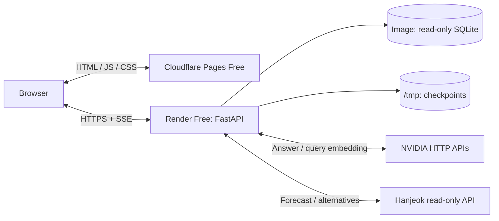

# 현재 배포 구조

2026-11-24 실제 배포와 검증 기록 기준이다. 공개 안내 API는 **Render Free + 읽기 전용
SQLite**, 화면은 **Cloudflare Pages Free**로 운영한다. 기존 Cloud Run·Neo4j 동거
구성과 Vercel 배포 명령은 [이전 배포 안내](archive/guide-before-sqlite/deploy.md)에 보존했다.
이전 README도 [한국어](archive/guide-before-sqlite/README.ko.md)와
[English](archive/guide-before-sqlite/README.md)로 볼 수 있다.

## 배포 위치와 연결



| 항목 | 배포된 값 |
| --- | --- |
| 공개 화면 | [agent.hanjeok.com/ko/ask](https://agent.hanjeok.com/ko/ask) |
| 프론트 프로젝트 | Cloudflare Pages `hanjeok-agent`, Production `main` |
| 안내 API | `https://hanjeok-guide.onrender.com` |
| Render 서비스 | `hanjeok-guide`, `srv-dc2epkrrjlhs73cgqp5g`, Free, Singapore |
| 소스 | `feat/guide-512mb-runtime`, 배포 확인 커밋 `5c576f9` |
| 이미지 정의 | [`bench/Dockerfile.api`](../bench/Dockerfile.api), context `bench/` |
| 공개 프로필 | [`deployment/guide-free/render.yaml`](../deployment/guide-free/render.yaml), `GUIDE_STORE=sqlite` |
| 프론트 패키징 | Next.js 16 + vinext → ESM Pages Worker와 정적 자산 |
| 상태 | uvicorn 워커1, 동시 질문1, 방문/한도는 메모리, 체크포인트는 `/tmp` |

화면을 내려주는 Pages와 질문을 받는 Render는 별도 서비스다. 브라우저가 Render의
`/guide/*`에 직접 접근하고 SSE로 조회 단계와 최종 답변을 받는다. API CORS는
`https://agent.hanjeok.com`을 허용한다. `pages.dev` 주소를 추가로 쓰려면 허용 오리진을
명시적으로 추가해야 한다.

## 이미지에 들어가는 것

공개 관광 export와 고정 위키, 검증한 동일 공간의 벡터를 운영자 작업으로 SQLite에
묶는다. 배포 시점 자료는 장소12,106개, 관계43,087개, 행사209개와 위키18문서/83청크다.
`bench/data/manifest.json`이 export와 위키 revision, 벡터 식별자, 건수, 압축/원본 해시를 묶는다.

Docker 빌드는 manifest가 가리키는 압축 파일의 해시를 확인하고 DB를 해제한다.
API 시작 시 원본 해시와 스키마, 건수, 두 코퍼스 벡터 식별자를 검사하고 읽기 전용으로 연다.
공개 컨테이너에 Neo4j 서버나 로컬 모델 가중치를 넣지 않는다. API는 질의 임베딩과
구조화 답변을 NVIDIA로 요청하고, 날짜별 예보와 대안만 한적 API에서 실시간 조회한다.

데이터 갱신은 새 파일을 만들어 재배포한다. 실행 중인 DB의 핫스왑이나 방문 상태의
영구 보존은 지원하지 않는다. 생성 명령과 캐시/위키 검증 조건은
[512MiB 프로필 문서](../deployment/guide-free/README.md)에 있다.

## 배포 순서

1. 작업 브랜치에 코드와 검증한 SQLite gzip/manifest를 커밋하고 푸시한다.
2. 로컬 이미지와 테스트를 확인한다. 실제 모델 검사는 기존 NVIDIA 키와 호출 한도를 사용한다.
3. Render에서 Dockerfile/context와 Free 플랜을 확인하고 지정 커밋을 배포한다.
   현재 서비스는 자동 배포를 사용하지 않으므로 Git push만으로 새 버전이 올라가지는 않는다.
4. API의 ready/status와 실제 SSE 질문, 원본 인용 및 CORS를 확인한다.
5. 새 API 주소를 프론트 환경 변수에 넣고 다시 빌드한 뒤 Pages 운영 환경에 배포한다.
6. 공개 사용자 도메인에서 질문과 최종 답변이 실제로 보이는지 확인한다.

### Render

필요한 시크릿은 기존 `NVIDIA_API_KEY`다. 값은 Render 시크릿/환경 변수로 주입하고
Git, Docker build argument나 프론트 환경 변수에 넣지 않는다. SQLite 프로필은 Aura 접속값을
요구하지 않는다. NVIDIA 무료 접근은 프로토타이핑 범위이며 상시 가용성을 보장하지 않는다.

환경 변수 예시와 조회/방문 한도는 [env.example](../deployment/guide-free/env.example)에 있다.
검증한 커밋을 기존 서비스에 배포할 때는 다음과 같이 실행할 수 있다.

```bash
render blueprints validate deployment/guide-free/render.yaml --output json --confirm
# 배포 확인된 커밋. 새 버전은 검증한 SHA로 바꾼다.
render deploys create srv-dc2epkrrjlhs73cgqp5g \
  --commit 5c576f94b0296cf3823ad77e932d52381f036735 --wait

curl -fsS https://hanjeok-guide.onrender.com/guide/ready
curl -fsS https://hanjeok-guide.onrender.com/guide/status
curl -sN https://hanjeok-guide.onrender.com/guide/ask \
  -H 'content-type: application/json' \
  -d '{"question":"혼잡 등급은 어떤 기준으로 나눠?","strategy":"graph"}'
```

`/guide/ready`는 데이터 준비 상태만 확인한다. NVIDIA나 한적 API까지 성공했다는 뜻은
아니므로 실제 질문에서 `answer`, 근거 레코드와 terminal `done`을 확인한다. 실패 보고서를
정상 완료로 집계하지 않는다.

### Cloudflare Pages

`frontend/.env.production.local`의 안내 API 주소는 아래 값이다. 브라우저에 포함되는
공개 주소이며 시크릿이 아니다. Kotlin 코스 설명기의 `NEXT_PUBLIC_AGENT_BASE_URL`은
별도이며 이번 Python API 이전으로 복구된 것은 아니다.

```dotenv
NEXT_PUBLIC_GUIDE_BASE_URL=https://hanjeok-guide.onrender.com
```

```bash
cd frontend
pnpm install --frozen-lockfile
pnpm test
pnpm build:pages
pnpm deploy:pages --branch main
```

`build:pages`는 `scripts/prepare-pages.mjs`로 단일 ESM `_worker.js`와 정적 자산을 만든다.
Wrangler는 [`deployment/cloudflare-pages/wrangler.jsonc`](../deployment/cloudflare-pages/wrangler.jsonc)를
사용한다. `--branch main`은 Pages 운영 환경을 선택하는 라벨로, Git main에 병합하는 명령이 아니다.
`NEXT_PUBLIC_*` 값은 빌드에 포함되므로 주소 변경 후 재빌드가 필요하다.

## 실제 확인과 남은 한계

[배포 확인 JSON](../bench/reports/runtime/sqlite-deployment.json)에는 Render deploy와
Pages deployment ID, 소스 커밋, corpus hash, 테스트와 화면 검증을 기록했다.
공개 ready/status200, 예보와 정책의 실제 조회/인용, 브라우저의 경복궁 예보 답변과
Ultra 모델/7.6초 표시를 확인했다. [검증 화면](../bench/reports/runtime/sqlite-public-forecast.jpg).

최종 소스 이미지의 로컬 512MiB/no-swap 검사에서 최대297.7MiB(20ms 표본), OOM0이었다.
이는 ARM 호스트의 amd64 에뮬레이션 결과이고 Render 자체의 장기 부하 측정값이 아니다.
SQLite 초기 배포 당시 백엔드525개와 프론트296개 테스트가 통과했고, 통합/실제 모델 검사43개는 기본 suite에서 제외했다.

모든 실응답 검사가 성공한 것은 아니다. 공개 대안 질문은 올바른 API 조회 뒤 모델 호출이
실패했고, 다른 로컬 검사에서는 정책 질문이 실패했다. 각 보고서의 `passed=false`를
보존했다. SQLite 전체60문항 품질 평가는 아직 실행하지 않았고, 과거 Neo4j 점수를 재사용하지 않는다.
무료 인스턴스의 절전과 모델 제공자의 호출 한도도 적용된다.

## 서버 연결을 기다리는 화면

질문 화면은 진입 시 `/guide/ready`로 API를 깨운다. 사용자는 준비되는 동안 질문을
작성하거나 잎새의 사용 팁 카드를 넘길 수 있다. 실서버 예시 질문은 입력창만 채우고
자동 전송하지 않는다. 제출한 질문은 준비 완료 뒤 한 번만 보내며, 연결 재시도와
취소 시 질문을 보존한다. 준비 확인 90초와 답변 스트림 90초는 별도 예산이다.

카드 조작은 연결 후에도 유지해 키보드 포커스를 보존한다. `/guide/ready` 성공은
데이터 준비이며 원격 모델의 응답 성공까지 보장하지 않는다.
[명세와 검증 기록](features/guide-warmup/tasks.md)에 테스트와 공개 배포 결과를 기록한다.

## 이전 구조와 기록

- [이전 배포 안내 전체](archive/guide-before-sqlite/deploy.md): Cloud Run/Vercel 명령,
  Kotlin 설정, 프론트의 첫 Cloudflare 이전과 당시 중단 상태.
- [이전 한국어 README](archive/guide-before-sqlite/README.ko.md): Neo4j와 로컬 임베딩을
  함께 띄우던 시스템 그림, 과거 데이터/평가 표.
- [코스 설명기](explainer/README.ko.md): Kotlin/Spring AI 컴포넌트의 설계와 실험.

기존 이미지와 소스, 평가 기록은 삭제하지 않는다. 현재 프로필로 이전 구조의 메모리나
응답 시간, 품질 점수를 보증하지 않는다.
